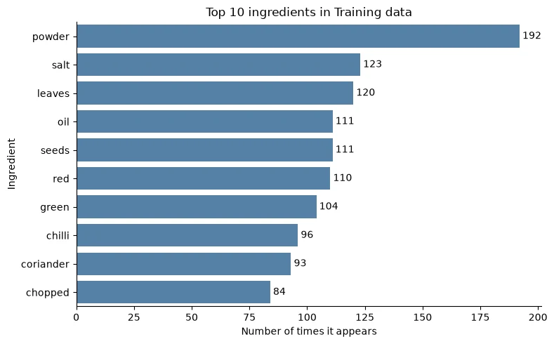
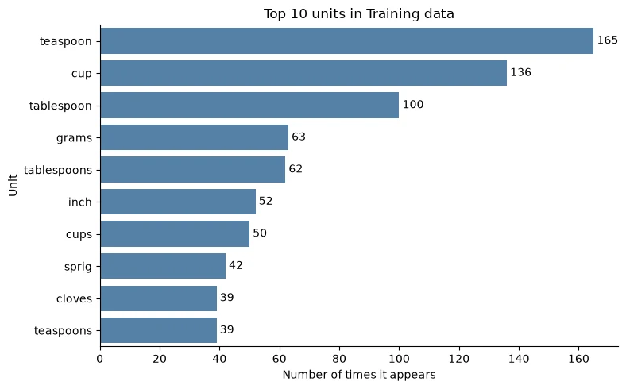
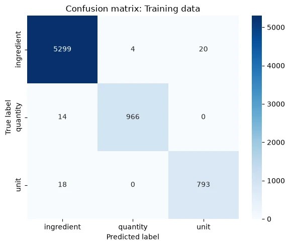

## Definition

**Named Entity Recognition (NER)** finds the words in a text that refer to specific kinds of things, and labels them.

In this project, the "things" are the parts of a recipe ingredient list. I built a model that reads raw ingredient text and tags **every word** as one of three labels:

| Word | 3 | tablespoon | Gram | flour |
| --- | --- | --- | --- | --- |
| **Label** | quantity | unit | ingredient | ingredient |

On recipes it had never seen, the model labeled **98.3%** of words correctly.

<Points>
  <Point term="Model">A Conditional Random Field with 32 hand-built features per word.</Point>
  <Point term="Data">285 labeled Indian recipes (280 after cleaning), 9,990 labeled words.</Point>
  <Point term="Stack">Python 3.11, spaCy 3.5.3, sklearn-crfsuite 0.5.0, pandas, scikit-learn, Matplotlib, Seaborn.</Point>
  <Point term="Context">A project in my Data Science and Machine Learning program.</Point>
</Points>

## The problem it solves

Recipe ingredients usually arrive as one long line of words, with no commas or fields:

```
6 Karela Bitter Gourd Pavakkai Salt 1 Onion 3 tablespoon Gram flour besan...
```

A person reads this easily because they know what food is. A program only sees characters. The task is to give every word one of three labels, so the text becomes structured data: **how much**, **measured in what**, **of which ingredient**.

**Why it matters.** Tagging thousands of recipes by hand is slow. With a reliable tagger, an app can search recipes by what's in your kitchen, scale servings, build shopping lists or estimate nutrition.

## The data

Each recipe comes with its ingredient text and a matching list of labels, one per word. After cleaning, the 196 training recipes contain **7,114 labeled words**:

| Label | Words | Share |
| --- | --- | --- |
| Ingredient | 5,323 | 74.8% |
| Quantity | 980 | 13.8% |
| Unit | 811 | 11.4% |

The classes are **imbalanced**. A model that always answered "ingredient" would already score about 75%, so I judged the model on **per-label recall**, not just overall accuracy.

## How it works

1. **Tokenize:** split each sentence and its label string into parallel word lists.
2. **Clean:** 5 recipes had one more word than labels. The alignment couldn't be recovered, so I removed them, leaving 280.
3. **Split:** 70% for training (196 recipes) and 30% for validation (84), split by recipe with a fixed seed.
4. **Explore:** count words per label and chart the most frequent ones.
5. **Engineer features:** describe every word with 32 features covering the word, its grammar, its characters, recipe keywords and its neighbors.
6. **Train:** fit a Conditional Random Field on 7,114 training words.
7. **Evaluate:** score the model on the 84 held-out recipes with precision, recall, F1 score and a confusion matrix.
8. **Analyze errors:** review all 50 validation mistakes in context to find their causes.

### Why a Conditional Random Field

A **Conditional Random Field (CRF)** labels a whole sentence at once. It scores each word's features, and it also learns **which label tends to follow which**, such as a unit after a quantity. That fits ingredient text, where a word's role depends heavily on its neighbors. It also trains in seconds on a small dataset, and its learned weights can be inspected.

## Key terms

<Points>
  <Point term="Token">One word or piece of text.</Point>
  <Point term="Feature">A measurable clue about a word that the model learns from.</Point>
  <Point term="Class weight">A number that makes rare labels count for more.</Point>
  <Point term="Precision">When the model predicts a label, how often it's right.</Point>
  <Point term="Recall">Of all the real cases of a label, how many the model found.</Point>
  <Point term="F1 score">The harmonic mean of precision and recall.</Point>
  <Point term="Confusion matrix">A table counting every pair of true and predicted labels.</Point>
  <Point term="Label leakage">When a feature secretly contains the answer, which inflates scores that then collapse on real data.</Point>
</Points>

## Implementation

### 1. Set up the environment

spaCy 3.5.3 has no build for Python 3.14, so I used Python 3.11 with `uv`, pinned NumPy below version 2, and installed the small English spaCy model from its release file.

```bash
uv venv .venv --python 3.11 --seed
source .venv/bin/activate
uv pip install "numpy<2" "spacy==3.5.3" "sklearn-crfsuite==0.5.0" pandas matplotlib seaborn ipykernel
python -m pip install "https://github.com/explosion/spacy-models/releases/download/en_core_web_sm-3.5.0/en_core_web_sm-3.5.0-py3-none-any.whl"
```

### 2. Load and clean the data

Each record has two space-separated strings: `input` (the ingredient text) and `pos` (one label per word). Splitting both on spaces gives two parallel lists per recipe.

```python
def load_json_dataframe(file_path):
    with open(file_path, 'r') as file:
        data = json.load(file)
    return pd.DataFrame(data)

df = load_json_dataframe('ingredient_and_quantity.json')

df['input_tokens'] = df['input'].str.split()
df['pos_tokens'] = df['pos'].str.split()
```

Every word needs exactly one label. Comparing list lengths found **5 recipes** where they differ. There's no reliable way to know which word lost its label, and guessing would teach the model wrong answers, so I removed them.

```python
df['input_length'] = df['input_tokens'].apply(len)
df['pos_length'] = df['pos_tokens'].apply(len)

df = df[df['input_length'] == df['pos_length']].reset_index(drop=True)
print('Shape after removing broken rows:', df.shape)
```

```
Shape after removing broken rows: (280, 6)
```

### 3. Split into training and validation sets

The split is done **by recipe, not by word**, so no sentence appears in both sets.

```python
train_df, val_df = train_test_split(df, test_size=0.3, random_state=42)

X_train = train_df['input_tokens'].tolist()
y_train = train_df['pos_tokens'].tolist()
X_val = val_df['input_tokens'].tolist()
y_val = val_df['pos_tokens'].tolist()
```

```
Training recipes: 196
Validation recipes: 84
```

### 4. Explore the training data

Counting the most frequent words per label shows what the model will see most. "powder", "red" and "green" are frequent ingredient tokens because they're pieces of longer names like "red chilli powder".



Teaspoon, tablespoon and cup, with their plurals, make up **68% of all unit words**, so a small keyword list covers most units.



### 5. Feature engineering

The model can't read words, so each one is turned into a set of **features**. These are the four features for "tablespoon" in "3 tablespoon Gram flour":

| Feature | Value |
| --- | --- |
| Is it on the unit keyword list? (`is_unit`) | Yes |
| Is the previous word a quantity? (`prev_is_quantity`) | Yes |
| Does it contain a digit? (`has_digit`) | No |
| Is it the first word? (`BOS`) | No |

First, three keyword sets and a number pattern that matches `2`, `1.5`, `1/2`, `1-1/2` and `2-3`:

```python
unit_keywords = {
    'teaspoon', 'teaspoons', 'tsp', 'tablespoon', 'tablespoons', 'tbsp',
    'spoon', 'spoons', 'cup', 'cups', 'gram', 'grams', 'gm', 'gms', 'kg',
    'ml', 'liter', 'liters', 'litre', 'litres', 'inch', 'inches', 'pinch',
    'sprig', 'sprigs', 'clove', 'cloves', 'stalk', 'stalks', 'handful',
    'fistful', 'scoop', 'scoops', 'drop', 'drops', 'wedge', 'wedges'
}

quantity_keywords = {
    'half', 'quarter', 'one', 'two', 'three', 'four', 'five', 'six',
    'seven', 'eight', 'nine', 'ten', 'dozen', 'few', 'little', 'some'
}

cooking_method_keywords = {
    'chopped', 'sliced', 'diced', 'minced', 'grated', 'crushed', 'ground',
    'peeled', 'boiled', 'fried', 'roasted', 'steamed', 'cooked', 'soaked',
    'melted', 'shredded', 'blanched', 'toasted'
}

quantity_pattern = re.compile(r'^\d+([./-]\d+)*$')
nlp = spacy.load('en_core_web_sm')
```

The core of the project is `word2features`, which turns one word into a dictionary of **32 features**. Two details matter:

- spaCy is given the **existing tokens** through `Doc`, because its own tokenizer would split `2-1/2` into three pieces and break the word-to-label alignment.
- Each sentence is **parsed once and cached**, which makes feature extraction much faster.

```python
from spacy.tokens import Doc

numeric_pattern = re.compile(r'^\d+(\.\d+)?$')      # 2 or 1.5
fraction_pattern = re.compile(r'^(\d+-)?\d+/\d+$')  # 1/2 or 1-1/2
decimal_pattern = re.compile(r'^\d+\.\d+$')         # 1.5

def is_quantity_word(word):
    return bool(quantity_pattern.match(word)) or word.lower() in quantity_keywords

def is_unit_word(word):
    return word.lower() in unit_keywords

doc_cache = {}

def get_doc(sent):
    key = tuple(sent)
    if key not in doc_cache:
        doc_cache[key] = nlp(Doc(nlp.vocab, words=sent))
    return doc_cache[key]

def word2features(sent, i):
    doc = get_doc(sent)
    token = doc[i]
    word = sent[i]
    prev_word = sent[i - 1] if i > 0 else ''
    next_word = sent[i + 1] if i < len(sent) - 1 else ''

    return {
        # The word itself
        'bias': 1.0,
        'token': word.lower(),
        'lemma': token.lemma_.lower(),
        'pos_tag': token.pos_,
        'tag': token.tag_,
        'dep': token.dep_,
        'shape': token.shape_,
        'is_stop': token.is_stop,
        'is_digit': word.isdigit(),
        'has_digit': any(ch.isdigit() for ch in word),
        'has_alpha': any(ch.isalpha() for ch in word),
        'hyphenated': '-' in word,
        'slash_present': '/' in word,
        'is_title': word[0].isupper(),
        'is_upper': word.isupper(),
        'is_punct': token.is_punct,

        # Recipe knowledge
        'is_quantity': is_quantity_word(word),
        'is_unit': is_unit_word(word),
        'is_numeric': bool(numeric_pattern.match(word)),
        'is_fraction': bool(fraction_pattern.match(word)),
        'is_decimal': bool(decimal_pattern.match(word)),
        'is_cooking_method': word.lower() in cooking_method_keywords,
        'preceding_word': prev_word,
        'following_word': next_word,

        # Neighbors
        'prev_token': prev_word.lower(),
        'prev_is_quantity': is_quantity_word(prev_word),
        'prev_is_digit': prev_word.isdigit(),
        'BOS': i == 0,
        'next_token': next_word.lower(),
        'next_is_unit': is_unit_word(next_word),
        'next_is_ingredient': next_word != '' and not is_unit_word(next_word) and not is_quantity_word(next_word),
        'EOS': i == len(sent) - 1,
    }

def sent2features(sent):
    return [word2features(sent, i) for i in range(len(sent))]
```

The features fall into five groups:

| Group | Features | Why |
| --- | --- | --- |
| **Word** | bias, token, lemma, shape | The word itself, its base form ("cups" becomes "cup") and its pattern ("Milk" becomes "Xxxx"). |
| **Grammar** | pos_tag, tag, dep, is_stop, is_punct | Part of speech, detailed tag and dependency role from spaCy. |
| **Characters** | is_digit, has_digit, has_alpha, hyphenated, slash_present, is_title, is_upper | Cheap surface clues: numbers, fractions and capital letters. |
| **Domain** | is_quantity, is_unit, is_numeric, is_fraction, is_decimal, is_cooking_method | Recipe knowledge from the keyword lists and number patterns. |
| **Context** | preceding_word, following_word, prev_token, next_token, prev_is_quantity, prev_is_digit, next_is_unit, next_is_ingredient, BOS, EOS | The neighbors. A unit usually follows a quantity and comes before an ingredient. |

### 6. Avoid label leakage

Rare labels get larger **class weights**, computed as total words divided by the label's count. The project brief also asked to lower the ingredient weight, so I halved it.

```python
label_counts = Counter(flatten_list(y_train))
total_samples = sum(label_counts.values())

weight_dict = {label: total_samples / count for label, count in label_counts.items()}
weight_dict['ingredient'] = weight_dict['ingredient'] * 0.5
```

```
{'quantity': 7.26, 'unit': 8.77, 'ingredient': 0.67}
```

The brief also asked to add each word's class weight **as a feature**. If that weight is looked up from the **true label**, the feature quietly gives the model the answer. I tested both options:

| Version | Accuracy |
| --- | --- |
| Weight from the true label, scored with labels available | 99.9% |
| The same model on new text, where true labels don't exist | **73.3%** |
| Final model, weight from a keyword-based guess | **98.3%** |

The leaky version looks almost perfect, then falls to 73.3% on real input, labeling nearly everything as an ingredient. A real application never has the true labels, so the weight comes from a **rule-based guess** that uses only the word itself:

```python
def guess_label(word):
    if is_quantity_word(word):
        return 'quantity'
    if is_unit_word(word):
        return 'unit'
    return 'ingredient'

def extract_features_with_class_weights(X, y, weight_dict):
    weighted_features = []
    for sent, labels in zip(X, y):
        features = sent2features(sent)
        for word, word_features in zip(sent, features):
            word_features['class_weight'] = weight_dict[guess_label(word)]
        weighted_features.append(features)
    return weighted_features

X_train_weighted = extract_features_with_class_weights(X_train, y_train, weight_dict)
X_val_weighted = extract_features_with_class_weights(X_val, y_val, weight_dict)
```

### 7. Train the model

Training learns a weight for every feature and label, plus a score for every **label-to-label transition**, such as quantity followed by unit.

```python
crf = sklearn_crfsuite.CRF(
    algorithm='lbfgs',
    c1=0.5,
    c2=1.0,
    max_iterations=100,
    all_possible_transitions=True
)
crf.fit(X_train_weighted, y_train)

joblib.dump(crf, 'crf_model.pkl')
```

| Setting | What it does |
| --- | --- |
| `algorithm='lbfgs'` | A memory-efficient gradient-based optimizer. |
| `c1=0.5` | Pushes unhelpful feature weights to exactly zero. |
| `c2=1.0` | Keeps any single feature weight from growing too large. |
| `all_possible_transitions=True` | Learns scores for every label pair, including pairs never seen in training. |

`sklearn-crfsuite` ignores a `class_weight` attribute, so the weights only reach the model through the feature added in step 6.

## Results

Training accuracy was **99.2%** and validation accuracy **98.3%**. The gap is under one point, so the model **generalizes** instead of memorizing the training recipes.

```python
y_pred_val = crf.predict(X_val_weighted)
print(flat_classification_report(y_val, y_pred_val, digits=3))
```

| Validation set | Precision | Recall | F1 | Words |
| --- | --- | --- | --- | --- |
| Ingredient | 0.984 | **0.994** | 0.989 | 2,107 |
| Quantity | 0.990 | **0.985** | 0.988 | 411 |
| Unit | 0.967 | **0.913** | 0.940 | 358 |
| **Overall accuracy** | | | **0.983** | 2,876 |




**Units are the weakest label.** They're the rarest class, and 31 real units were predicted as ingredients.

## Error analysis

I reviewed every validation mistake in context. Most aren't random: they cluster around a few words, and many trace back to the **labels themselves**.

```python
for sent, true_labels, pred_labels in zip(X_val, y_val, y_pred_val):
    for i, (token, true_label, pred_label) in enumerate(zip(sent, true_labels, pred_labels)):
        if true_label != pred_label:
            context = ' '.join(sent[max(0, i - 2):i + 3])
            error_data.append({'token': token, 'true_label': true_label,
                               'pred_label': pred_label, 'context': context})
```

| Pattern | What happened | Mistakes |
| --- | --- | --- |
| **Describing and linking words labeled as units** | Words like finely, cut, small, green, diced and toasted, and linking words like to, into and and. None are measures, but the dataset labels them as units. The model called them ingredients. | 24 |
| **"cloves"** | Sometimes a unit ("2 cloves garlic"), sometimes the spice. The dataset labels it inconsistently. | 11 |
| **"few"** | Labeled ingredient all 3 times. The model said quantity. | 3 |
| **"a" before "pinch"** | Labeled quantity once, unit once and ingredient once, so there's no consistent answer to learn. | 3 |
| **"gram" in "black gram"** | Here gram is a lentil. The model said unit because "gram" is on the unit keyword list. | 1 |
| **Other one-off cases** | is, to, for, pinch, clove, cm, bud, Tbsp. | 8 |
| **Total** | | **50** |

**Main finding:** at least **34 of the 50 mistakes** involve labels that are inconsistent or questionable. In several cases, the model's answer is the more sensible one. **Cleaning the labels would likely improve results more than changing the model.**

## Next steps

- **Fix inconsistent labels.** Agree on one rule for describing words, "cloves", "few" and "a pinch", then relabel. This targets most of the remaining errors.
- **Add more data**, especially recipes with rare units and cuisines beyond Indian cooking, which dominates this dataset.
- **Add context-aware features.** For example, "cloves" followed by "garlic" is a measure, and "gram" after "black" or before "dal" is food.
- **Use real class weighting.** sklearn-crfsuite ignores `class_weight`, so imbalance would need oversampling of rare-label sentences or a model that supports a weighted loss.

## TL;DR

- **Named Entity Recognition** tags every word in a recipe's ingredient list as a quantity, a unit or an ingredient.
- A **Conditional Random Field** with **32 hand-built features** per word reached **98.3%** validation accuracy, with ingredient recall 99.4%, quantity 98.5% and unit 91.3%.
- **Context features matter most:** a unit usually follows a quantity and comes before an ingredient.
- Adding a class weight from the **true label** leaks the answer: 99.9% in testing, 73.3% on real text. A **keyword-based guess** avoids it.
- Most of the 50 remaining errors come from **inconsistent labels**, so better data beats a bigger model here.
