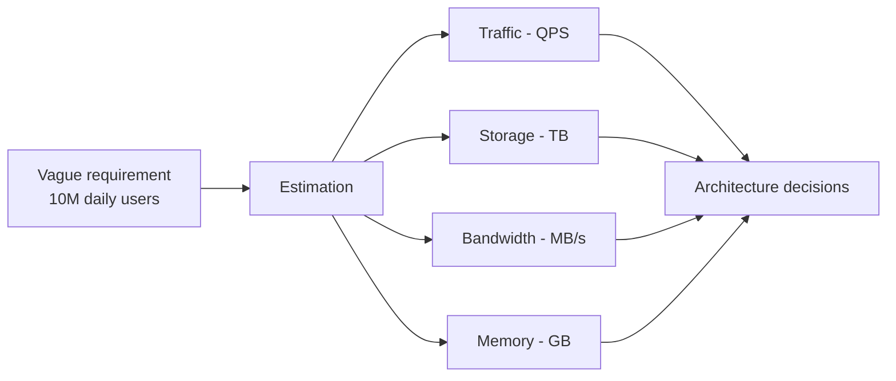

## Definition

**Back-of-the-envelope estimation** is rough arithmetic — done in minutes, with rounded numbers — that converts a requirement like *"10 million daily users"* into concrete figures: requests per second, terabytes of storage, gigabits of bandwidth, gigabytes of cache.

The goal is the right **order of magnitude**, not the right answer. Being off by 20% is fine. Being off by 1000× is a broken design.

---

## The problem it solves

A design decision is only correct relative to a scale. One database server is right at 100 requests per second and catastrophic at 100,000.

Without numbers, a system gets built on intuition — either over-engineered (a distributed cluster for 5,000 users) or under-engineered (a single node that collapses in month two). Estimation produces the numbers that make the choice obvious instead of debatable.



---

## How it works

### Step 1 — Pick the dominant action

A system has many endpoints, but almost all load comes from one or two of them. Estimate those; ignore the settings page.

For a photo service the dominant actions are *upload a photo* (write) and *view a photo* (read). Everything else is rounding error.

### Step 2 — Know the numbers cold

These are memorised, not derived. They make the arithmetic doable without a calculator.

**Time**

| Quantity | Exact | Use this |
| --- | --- | --- |
| Seconds in a day | 86,400 | **100,000** (10<sup>5</sup>) |
| Seconds in a month | 2,592,000 | 2.5 million |
| Days in a year | 365 | 400 |

Rounding 86,400 up to 100,000 makes every division a shift of the decimal point. The result comes out ~15% low, which is inside the tolerance.

**Data sizes**

| Unit | Bytes | Order |
| --- | --- | --- |
| KB | 10<sup>3</sup> | thousand |
| MB | 10<sup>6</sup> | million |
| GB | 10<sup>9</sup> | billion |
| TB | 10<sup>12</sup> | trillion |
| PB | 10<sup>15</sup> | quadrillion |

**Typical object sizes**

| Object | Rough size |
| --- | --- |
| One character (ASCII) | 1 byte |
| A short text post / tweet | 300 bytes |
| A database row of metadata | 1 KB |
| A web page (HTML only) | 100 KB |
| A phone photo, compressed | 300 KB – 3 MB |
| One minute of 1080p video | 30 MB |

**Latency, rounded**

| Operation | Time |
| --- | --- |
| Read from RAM | 100 nanoseconds |
| Read from SSD | 100 microseconds |
| Disk seek | 10 milliseconds |
| Network round trip inside one datacenter | 0.5 ms |
| Network round trip across the world | 150 ms |

RAM is roughly 100,000× faster than a disk seek. That single ratio is the reason caching exists.

### Step 3 — Derive traffic

Traffic is measured in **QPS** — queries per second, the number of requests the system handles each second.

```
Daily requests = Daily Active Users x actions per user per day
Average QPS    = Daily requests / 100,000
Peak QPS       = Average QPS x 2 to 3
```

Traffic is never spread evenly across 24 hours; it clusters into a few busy hours. The peak multiplier of 2–3× accounts for that, and capacity is always planned against the peak, never the average.

### Step 4 — Derive storage, bandwidth, memory

Each one falls out of the traffic number plus one size assumption.

```
Storage   = writes per day x size per write x retention in days
Bandwidth = QPS x size per request
Memory    = size of the "hot" subset that should live in RAM
```

For memory, the usual starting assumption is the **80/20 rule**: about 20% of the data serves about 80% of the requests. Cache that 20%.

### Step 5 — Worked example

**Requirement:** a photo-sharing service. 10 million daily active users. Each uploads 1 photo per day and views 20. Average photo is 300 KB. Data is kept for 5 years.

**Traffic**

| Quantity | Working | Result |
| --- | --- | --- |
| Writes/day | 10M × 1 | 10 million |
| Reads/day | 10M × 20 | 200 million |
| Write QPS | 10<sup>7</sup> / 10<sup>5</sup> | 100 |
| Read QPS | 2×10<sup>8</sup> / 10<sup>5</sup> | 2,000 |
| Peak read QPS | 2,000 × 2 | 4,000 |

The read-to-write ratio is 20:1. That ratio alone justifies read replicas and a cache layer.

**Storage**

| Quantity | Working | Result |
| --- | --- | --- |
| Per day | 10<sup>7</sup> × 300 KB | 3 TB |
| Per year | 3 TB × 365 | ~1.1 PB |
| Over 5 years | 1.1 PB × 5 | ~5.5 PB |

Petabytes rule out a single disk and point to object storage plus replication.

**Bandwidth**

| Direction | Working | Result |
| --- | --- | --- |
| Write (ingress) | 100 × 300 KB | 30 MB/s |
| Read (egress) | 2,000 × 300 KB | 600 MB/s |

600 MB/s is roughly 5 Gbps of outbound traffic — enough to make a CDN a requirement rather than an optimisation.

**Memory**

| Quantity | Working | Result |
| --- | --- | --- |
| Hot set (20% of a day's photos) | 2M × 300 KB | ~600 GB |

600 GB does not fit on one machine's RAM, so the cache itself has to be a distributed cluster.

**What the numbers decided:** object storage over a filesystem, a CDN for reads, read replicas because of the 20:1 ratio, and a distributed cache rather than a single node. None of that was intuition.

### The same calculation in code

```js
// All sizes in bytes, all times in seconds.
const SECONDS_PER_DAY = 100_000; // 86,400 rounded up for easy math
const KB = 1e3, MB = 1e6, TB = 1e12;

function estimate({ dau, writesPerUser, readsPerUser, objectBytes, retentionDays }) {
  const writesPerDay = dau * writesPerUser;
  const readsPerDay = dau * readsPerUser;

  const writeQps = writesPerDay / SECONDS_PER_DAY;
  const readQps = readsPerDay / SECONDS_PER_DAY;

  return {
    writeQps,                                   // 100
    readQps,                                    // 2000
    peakReadQps: readQps * 2,                   // 4000 — plan against this
    storageBytes: writesPerDay * objectBytes * retentionDays,
    readBandwidthPerSec: readQps * objectBytes, // egress
    hotCacheBytes: writesPerDay * 0.2 * objectBytes, // 80/20 rule
  };
}

const r = estimate({
  dau: 10e6, writesPerUser: 1, readsPerUser: 20,
  objectBytes: 300 * KB, retentionDays: 365 * 5,
});

console.log(`${r.peakReadQps} peak QPS`);                        // 4000 peak QPS
console.log(`${(r.storageBytes / TB).toFixed(0)} TB`);           // 5475 TB
console.log(`${(r.readBandwidthPerSec / MB).toFixed(0)} MB/s`);  // 600 MB/s
```

### Rules of thumb for sanity-checking

| Claim | Rough limit for one commodity server |
| --- | --- |
| Simple requests served | ~1,000–10,000 QPS |
| Database writes | ~1,000–5,000 per second |
| RAM available | 64–256 GB |
| Network interface | 10 Gbps |

If an estimate says one server handles 500,000 QPS, the estimate is wrong — not the server.

---

## Key terms

| Term | Plain-English meaning |
| --- | --- |
| **DAU** | Daily active users — people who use the system on a given day. |
| **QPS** | Queries per second — requests arriving each second. |
| **Peak QPS** | The busiest second of the day; capacity is sized for this. |
| **Read:write ratio** | How many reads happen per write. High ratios favour caching and replicas. |
| **Hot data** | The small slice of data requested most often. |
| **Ingress / egress** | Data flowing into the system / out of it. Egress is usually what costs money. |
| **Retention** | How long data is kept before deletion or archival. |
| **Order of magnitude** | A factor of 10. Estimation aims to get this right. |

---

## Trade-offs

| Choice | Buys you | Costs you |
| --- | --- | --- |
| Round 86,400 → 100,000 | Arithmetic done in the head, no calculator | ~15% underestimate |
| Estimate only the dominant action | Fast, focused numbers | Misses load from a rare-but-expensive endpoint |
| Size for peak, not average | System survives the busy hour | Hardware idle most of the day |
| Assume 80/20 for caching | A concrete cache size in one step | Wrong for uniform-access workloads |
| Fewer assumptions | Faster to produce, easier to check | Wider error bars |
| More assumptions | Tighter numbers | Slower, and each assumption is another thing that can be wrong |

---

## In the wild

- **Twitter** designed its timeline around a read-heavy ratio — reads vastly outnumber writes — so timelines are precomputed on write and cached, rather than assembled on read.
- **Netflix** ships content to edge servers inside ISP networks because egress bandwidth estimates at video scale make serving from central datacenters impractical.
- **YouTube** stores multiple encoded renditions of every upload, so storage estimates multiply the raw upload size several times over.
- **Discord** moved its message store to a database chosen after estimating trillions of rows, a figure reached long before the data existed.

---

## When to use

- Early in a design, before choosing databases, caches, or server counts.
- When deciding whether one machine can hold the workload at all.
- To sanity-check a proposal that "feels" too big or too small.
- To compare two designs on cost or bandwidth without building either.

## When to avoid

- Tuning an existing system — production metrics beat estimates every time.
- Anything requiring precision: billing, capacity contracts, SLA guarantees.
- Workloads with no plausible base number, where the estimate is guesswork wearing math.

---

## TL;DR

- Estimation converts a vague requirement into **traffic, storage, bandwidth, and memory** figures.
- Target the **order of magnitude**, not accuracy — 20% off is fine, 1000× off is a broken design.
- Round seconds-per-day to **100,000** so every division becomes a decimal shift.
- Traffic first: `DAU × actions/day ÷ 100,000 = average QPS`, then **×2–3 for peak**.
- Storage, bandwidth, and memory all derive from traffic plus one size assumption.
- The **read:write ratio** is often the single most decision-shaping number produced.
- Sanity-check against server limits: ~1,000–10,000 QPS and 64–256 GB RAM per commodity machine.