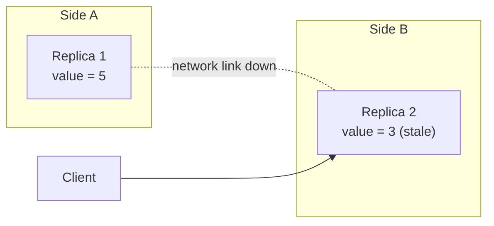

## Definition

**Consistency** is the guarantee that every read returns the most recent write, so all copies of the data agree on what the current value is.

The **CAP theorem** states that a distributed system experiencing a network partition must choose between consistency and availability. It cannot guarantee both while the partition lasts.

## The problem it solves

Consistency only becomes a question when data exists in more than one place. A single machine cannot disagree with itself.

Copies exist for good reasons: a replica survives the loss of the original, and a copy near the user answers faster. Every copy added introduces the possibility that two copies hold different values at the same moment.

## How it works

### A partition is a communication failure, not a machine failure

A **network partition** is when machines are individually healthy but cannot reach each other — a severed link, a dropped route, a region losing connectivity.



Replica 2 is running and can accept the request. It simply cannot confirm with Replica 1 whether its value is current.

### The choice a partition forces

With the link down, the replica receiving a read has exactly two options.

| Option | Behavior | Preserves | Sacrifices |
| --- | --- | --- | --- |
| Answer from the local copy | Returns `3`, possibly stale | Availability | Consistency |
| Refuse to answer | Returns an error such as `503` until the link heals | Consistency | Availability |

No third option exists. This is the entirety of the CAP theorem.

### CAP is not "pick two of three"

The three properties are consistency (C), availability (A), and partition tolerance (P). CAP is commonly summarized as choosing two, which misstates it.

**P is not a design choice.** Networks fail, so any system spanning multiple machines must tolerate partitions. The real decision is what the system does *while* partitioned.

| Behavior during a partition | Called | Typical fit |
| --- | --- | --- |
| Rejects requests rather than serve stale data | **CP** | Account balances, inventory counts, payments, unique-ID assignment |
| Serves possibly-stale data rather than error | **AP** | Social feeds, product reviews, view counts, DNS, content catalogs |

When there is no partition, a system provides both consistency and availability. CAP constrains behavior only during the failure, which is a small fraction of a system's running time.

### The consistency spectrum

Consistency is not binary. Two common points on the spectrum:

- **Strong consistency** — a read is not served until every replica reflects the write. Always correct, but every write pays a coordination delay, and reads stall during a partition.
- **Eventual consistency** — reads are served immediately from any replica and may return an older value. If writes stop, all replicas converge on the same value given enough time.

"Eventual" describes timing, not correctness. It does not mean the data is permanently wrong; it means the guarantee is convergence rather than immediacy.

### Eventual consistency is the cost of choosing AP

An AP system stays available during a partition by allowing replicas to diverge. Eventual consistency is the mechanism that repairs that divergence once the network heals.

Repair requires a rule for which value wins when two replicas disagree.

| Conflict resolution | How it decides | Risk |
| --- | --- | --- |
| Last-write-wins | Highest timestamp overwrites the rest | A concurrent write is silently discarded |
| Version vectors | Tracks causality, flags true conflicts | Application must resolve flagged conflicts |
| Merge / CRDT | Combines both values by a defined rule | Only works for data types with a valid merge |

```js
// Last-write-wins: simple, and lossy.
// Two replicas accepted a write during a partition.
const replicaA = { value: 5, updatedAt: 1724900000 };
const replicaB = { value: 3, updatedAt: 1724900007 };

// On heal, the newer timestamp wins outright.
const winner = replicaA.updatedAt > replicaB.updatedAt ? replicaA : replicaB;
// winner.value === 3 — the write of 5 is gone, with no error raised.
```

The real cost of AP is not staleness alone. It is that the application must define what a correct merge means.

## Key terms

| Term | Plain-English meaning |
| --- | --- |
| Consistency | Every read returns the most recent write |
| Replica | One of several copies of the same data |
| Network partition | Machines are healthy but cannot communicate |
| Partition tolerance | Continuing to operate while machines cannot reach each other |
| CP system | Sacrifices availability during a partition to stay correct |
| AP system | Sacrifices consistency during a partition to stay responsive |
| Strong consistency | No read is served until all replicas reflect the write |
| Eventual consistency | Replicas converge on the same value once writes stop |
| Stale read | A read returning a value that has since been overwritten |
| Conflict resolution | The rule deciding which value wins when replicas disagree |
| Last-write-wins (LWW) | Resolution by newest timestamp |
| Quorum | A minimum number of replicas that must acknowledge an operation |

## Trade-offs

| Choice | Buys you | Costs you |
| --- | --- | --- |
| Strong consistency | Reads are always correct; no conflict logic needed | Coordination latency on every write; unavailable during partitions |
| Eventual consistency | Stays available and fast; tolerates partitions | Stale reads; application must define conflict resolution |
| CP during a partition | Never serves a wrong value | Requests fail while the partition lasts |
| AP during a partition | Always returns something | Divergent replicas that must be reconciled afterward |
| Last-write-wins | Trivial to implement, no application logic | Concurrent writes can be lost silently |
| More replicas | Better fault tolerance and read locality | More copies to keep in agreement; wider partition exposure |

## In the wild

- **PostgreSQL** and **MySQL** with synchronous replication behave as CP systems: a write is not acknowledged until a replica confirms it, and the write path stalls if that replica is unreachable.
- **Cassandra** and **DynamoDB** default toward AP, accepting writes on any reachable replica and reconciling afterward, with tunable consistency levels for stricter paths.
- **DNS** is deliberately AP — resolvers serve cached records that may be outdated, because a stale address answers far more requests successfully than no address at all.
- **Payment and ledger systems** are built CP: a transaction that cannot be confirmed against authoritative state is rejected rather than accepted on a possibly-stale balance.

## When to use / avoid

**Choose consistency (CP) when**

- A stale value causes financial, legal, or safety harm.
- Two clients must never both succeed at claiming the same resource.
- Correctness is easier to defend than uptime for that specific data.

**Choose availability (AP) when**

- Brief staleness is unnoticeable or harmless to the user.
- Reads vastly outnumber writes and are tolerant of small delays in propagation.
- An error is worse for the user experience than a slightly outdated answer.

**Reconsider the framing when**

- The system runs on a single machine — no partition is possible, so CAP does not apply.
- The choice is being made system-wide. The decision belongs to each data path, not the whole application.

## TL;DR

- **Consistency** means every read sees the latest write; it only becomes a problem once data has more than one copy.
- A **partition** is machines being unable to communicate, not machines being down.
- **CAP**: during a partition, a system must choose consistency or availability — never both.
- **P is not optional**, so the practical question is whether a system behaves as **CP** or **AP** while partitioned.
- **Strong consistency** waits for agreement; **eventual consistency** answers now and converges later.
- Eventual consistency requires **conflict resolution**, and simple rules like last-write-wins can discard data silently.
- The choice follows the data, not the system: balances go CP, feeds and counts go AP, within the same application.