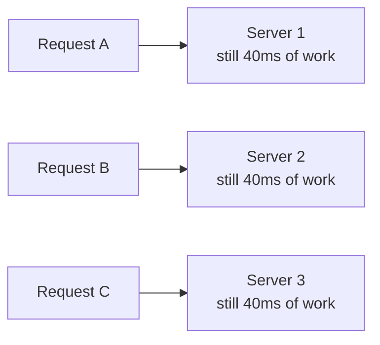

## Definition

**Latency** is the time a single request takes to complete, measured in milliseconds.

**Throughput** is the number of requests a system completes per unit of time, measured in requests per second, queries per second (QPS), or bytes per second.

Latency describes one request. Throughput describes many. A system can be strong at one and weak at the other.

## The problem it solves

"The system is slow" is two different complaints. One user waiting a long time for a page and a system unable to keep up with traffic are separate failures with separate fixes.

Separating latency from throughput makes the diagnosis precise: whether the work inside a request is too slow, or whether requests are arriving faster than capacity allows.

## How it works

### They are independent measurements

A pipe illustrates the separation. Throughput is how much water exits per second. Latency is how long one drop takes to travel end to end.

| Pipe | Throughput | Latency |
| --- | --- | --- |
| Wide and long | High — large volume per second | High — each drop travels far |
| Narrow and short | Low — small volume per second | Low — each drop arrives quickly |

| | Latency | Throughput |
| --- | --- | --- |
| Answers | How long did this request take? | How many requests per second? |
| Unit | Milliseconds | Requests/sec, QPS, MB/s |
| Better means | Lower | Higher |
| Scope | One request | The system under load |

### Scaling out raises throughput, not latency

A single request is handled by a single server. Adding servers does not divide that request into parts; it allows a *different* request to be served in parallel.

The work inside the request is unchanged — the same query, the same serialization, the same network hop.



More lanes on a road increase cars per hour. They do not raise the speed limit.

### Queuing is what connects them

When requests arrive faster than the system completes them, the excess waits in a queue. That wait is added to every request's total time.

- **Below capacity** — latency is dominated by actual work. Adding throughput headroom changes little.
- **Near capacity** — queue depth grows, and latency rises sharply rather than gradually.
- **Above capacity** — latency grows without bound until requests time out.

This is the practical link: a throughput ceiling reaches users disguised as a latency problem.

### Improving one can cost the other

**Batching** groups many small operations into one larger one. Fewer round trips means higher throughput, but each request waits for its batch to fill before being sent.

```js
// Unbatched: 1 write per request. Low latency, low throughput.
await db.insert(record); // ~5ms per call, one round trip each

// Batched: buffer, then flush together.
// Throughput rises; each record waits up to 50ms for the flush.
buffer.push(record);
if (buffer.length >= 100) {
  await db.insertMany(buffer); // one round trip for 100 records
  buffer.length = 0;
}
```

The reverse also holds: reducing latency by doing work eagerly, or holding more in memory, consumes resources that could have served additional concurrent requests.

### Averages hide the worst experiences

Consider 100 requests: 99 complete in 10ms, one takes 5,000ms. The mean is roughly 60ms — a value no request actually took.

**Percentiles** avoid this by sorting all requests from fastest to slowest and reading the value at a given position.

| Metric | Meaning |
| --- | --- |
| p50 (median) | Half of requests were faster than this. The typical experience. |
| p95 | 95% were faster. 1 in 20 requests was worse. |
| p99 | 99% were faster. The slow tail, at 1 in 100. |

**Tail latency** is the slow end of that distribution. It is measured, not averaged away, because the mean is distorted by exactly the outliers that matter most.

### Why the tail compounds

A single page often requires many backend calls, and it cannot render until all of them return. A slow response anywhere in the fan-out delays the whole page.

```js
// Each call independently has a 1% chance of hitting the slow tail.
const perCallFast = 0.99;

Math.pow(perCallFast, 10);  // ≈ 0.904 → ~10% of pages hit a slow call
Math.pow(perCallFast, 100); // ≈ 0.366 → ~63% of requests hit a slow call
```

A 1% tail at the service level becomes a 10% failure rate at the page level across ten calls. The rare case stops being rare once it is multiplied by fan-out.

### What causes the tail

The same code, on the same server, with the same input, can take 10ms once and 500ms the next time. The variation usually comes from the environment rather than the request.

| Cause | What is happening |
| --- | --- |
| Queuing | The request waits behind others before work begins |
| Cache miss | This request does work the others avoided |
| Garbage collection pause | The runtime briefly stops the process mid-request |
| Noisy neighbour | A co-tenant VM saturates shared CPU, disk, or network |
| Network retransmit | A dropped packet forces a retry with a backoff delay |
| Uneven data size | The same endpoint does more work for a larger account |

Only the last is a property of the request itself. The rest are timing and contention, which is why tail latency can be reduced but never eliminated.

## Key terms

| Term | Plain-English meaning |
| --- | --- |
| Latency | Time for one request to complete |
| Throughput | Requests completed per unit of time |
| QPS | Queries per second, a common throughput unit |
| Percentile (pN) | The value at position N when all requests are sorted by duration |
| p50 / median | The typical request duration |
| p99 | The duration only 1% of requests exceed |
| Tail latency | The slow end of the latency distribution |
| Queuing delay | Time spent waiting before work starts |
| Fan-out | One incoming request triggering many downstream calls |
| Batching | Grouping operations to reduce per-operation overhead |
| Saturation | Load at or beyond the system's capacity |
| Head-of-line blocking | One slow item delaying everything queued behind it |

## Trade-offs

| Choice | Buys you | Costs you |
| --- | --- | --- |
| Scale out | Higher throughput, more concurrency | Single-request latency unchanged; more coordination |
| Batching | Higher throughput, fewer round trips | Added latency while a batch fills |
| Caching | Lower latency and higher throughput on hits | Stale data risk; misses pay full cost, widening the tail |
| Optimizing p99 over the mean | Protects the worst-served users and fan-out paths | Often more expensive than improving the typical case |
| Running near full capacity | Efficient use of hardware | Small traffic spikes cause disproportionate latency growth |
| Headroom (spare capacity) | Stable latency under bursts | Paid-for capacity sits idle much of the time |

## In the wild

- **Amazon** publicly tied added page latency to measurable drops in sales, which set the industry norm of treating latency as a product metric rather than an infrastructure one.
- **Google** described the tail-at-scale problem, noting that services fanning out to many machines are governed by their slowest responder, not their average one.
- **CDNs** reduce latency by serving content from a nearby edge location, shortening physical distance rather than making origin servers faster.
- **Message queues** such as Kafka trade per-message latency for very high throughput by batching records and writing them sequentially to disk.

## When to use / avoid

**Optimize latency when**

- A human is waiting on the response.
- The call sits on a fan-out path where its delay blocks other work.
- The system is below capacity, so queuing is not the cause.

**Optimize throughput when**

- Work is asynchronous — batch jobs, ingestion pipelines, background processing.
- Requests are queuing, since capacity is what latency is actually waiting on.
- Cost per request matters more than the duration of any single one.

**Measure before either when**

- Only the mean is available. It conceals the tail that users encounter.
- The bottleneck is unidentified. Optimizing a component that is not the constraint changes nothing.

## TL;DR

- **Latency** is the duration of one request; **throughput** is requests per second. They are separate measurements.
- Adding servers raises throughput without shortening the work inside a single request.
- **Queuing** links them: once arrival rate exceeds capacity, latency rises sharply.
- **Batching** trades latency for throughput; the reverse trade also holds.
- Averages hide outliers, so latency is reported in **percentiles** — p50, p95, p99.
- Tail latency compounds under **fan-out**: a 1% slow rate becomes ~10% across ten calls.
- The tail comes mostly from queuing, cache misses, GC pauses, and contention, not from bad code.