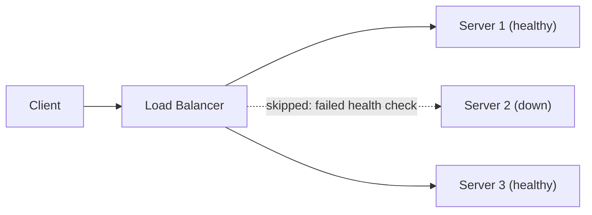

## Definition

**Reliability** is a system's ability to consistently produce the correct result when asked.
**Availability** is a system's ability to respond to requests at all, correct or not, usually expressed as a percentage of uptime such as 99.9%.
**Fault tolerance** is a system's ability to keep operating when one of its components fails, instead of the whole system going down with it.

## The problem it solves

Individual components fail: disks die, network links drop, processes crash, regions lose power. A system built assuming nothing ever fails goes down the first time something does.
Fault tolerance exists to stop one broken part from becoming a total outage. Reliability and availability are the two properties a system is protecting when it tolerates a fault.

## How it works

### Reliability and availability are independent

A system can have one without the other.

| Scenario | Reliable? | Available? |
| --- | --- | --- |
| Responds instantly with correct data | Yes | Yes |
| Is down, returns nothing | No (unmeasurable) | No |
| Responds instantly but with stale or wrong data | No | Yes |
| Takes 30 seconds but eventually returns correct data | Yes | Degraded |

### Calculating availability

Availability is measured as the fraction of time a system was up over a given period.

```
Availability = Uptime / (Uptime + Downtime)
```

It is almost always written as a percentage, and spoken of in **"nines"** — the number of leading 9s in that percentage. More nines means less permitted downtime.

| Availability | Name | Downtime per year | Downtime per month |
| --- | --- | --- | --- |
| 99% | two nines | 3.65 days | 7.2 hours |
| 99.9% | three nines | 8.77 hours | 43.8 minutes |
| 99.99% | four nines | 52.6 minutes | 4.4 minutes |
| 99.999% | five nines | 5.26 minutes | 26 seconds |

Each additional nine cuts allowed downtime by roughly 10x, and typically costs far more than the previous one to achieve.

**Availability of components in series** — when a request must pass through several components, and any one failing breaks the request, their availabilities multiply.

```js
// Three services in a request path, each 99.9% available on its own.
const overall = 0.999 * 0.999 * 0.999; // 0.997002 → 99.7%
// Chaining dependencies LOWERS total availability.
```

**Availability of components in parallel** — with redundant copies, the system is down only if *all* of them are down, so availability rises.

```js
// Two redundant replicas, each 99% available.
const bothDown = (1 - 0.99) * (1 - 0.99); // 0.0001
const overall = 1 - bothDown;             // 0.9999 → 99.99%
// Redundancy RAISES total availability.
```

This is the arithmetic case for redundancy: adding parallel copies is what buys back the availability that long dependency chains give away.

### Fault tolerance is what connects them

When a component fails, a fault-tolerant system has already planned for it — usually through redundancy: extra copies of the same component standing by.



If Server 2 fails, the load balancer stops routing to it and the remaining servers absorb the load. The system stays available. Whether it also stays reliable depends on whether the surviving servers hold the same correct data Server 2 had.

### Fail-open vs fail-closed

When a fault is detected, a system defaults to one of two behaviors.

| Mode | Behavior on failure | Optimizes for |
| --- | --- | --- |
| Fail-open | Serves a fallback, cached, or partial response instead of an error | Availability |
| Fail-closed | Refuses to respond rather than risk an incorrect one | Reliability |

A video platform showing a cached thumbnail instead of a live one is failing open. A payment system that halts rather than risk double-charging a card is failing closed.

### Redundancy patterns

- **Replication** — multiple copies of data on different machines, so losing one doesn't lose the data.
- **Failover** — a standby component takes over automatically when the primary fails.
- **Retries with backoff** — a client re-attempts a failed request after a short, increasing delay, absorbing brief blips.
- **Circuit breaker** — a client stops calling a failing dependency for a cooldown period, instead of overwhelming it further.

## Key terms

| Term | Plain-English meaning |
| --- | --- |
| Reliability | Always returns the correct result |
| Availability | Responds at all, regardless of correctness |
| Uptime | Percentage of time a system is available, e.g. 99.9% |
| Nines | Shorthand for an availability target by its leading 9s — 99.99% is "four nines" |
| Downtime budget | The amount of downtime an availability target still permits |
| Series dependency | Components chained so that any one failing breaks the request |
| Fault tolerance | Keeps operating when a component fails |
| Redundancy | Extra copies of a component, ready to take over |
| Failover | Automatic switch to a standby component |
| Fail-open | Degrades gracefully rather than erroring out |
| Fail-closed | Refuses to respond rather than risk a wrong answer |
| Circuit breaker | Stops calling a dependency that is already failing |
| Single point of failure (SPOF) | Any one component whose failure takes down the whole system |

## Trade-offs

| Choice | Buys you | Costs you |
| --- | --- | --- |
| Redundancy (replicas, standbys) | Survives component failure without downtime | More infrastructure, more cost, data must stay in sync |
| Fail-open | Higher availability during a fault | Risk of serving stale or wrong data |
| Fail-closed | Guaranteed correctness | Lower availability during a fault |
| Retries with backoff | Absorbs brief, transient failures | Can amplify load on an already struggling dependency if backoff is too short |
| Circuit breaker | Protects a failing dependency from being overwhelmed | Requests fail fast during the cooldown window, even ones that might have succeeded |

## In the wild

- **Amazon S3** replicates every object across multiple facilities within a region, so a single disk or server failure never loses data.
- **Netflix** built the Chaos Monkey tool to randomly kill production instances on purpose, forcing every service to prove it tolerates failure.
- **DNS** resolvers cache previous answers, so a lookup can still succeed — failing open — even if the authoritative server is briefly unreachable.
- **Payment processors** typically fail closed on write paths — a charge that can't be confirmed successful is treated as failed rather than retried blindly, to avoid duplicate charges.

## When to use / avoid

**Invest in fault tolerance when**

- The system has real users affected by downtime or data loss.
- Components are known to fail regularly at scale — disks, network links, individual servers.
- The cost of an outage is higher than the cost of redundancy.

**Skip or defer it when**

- The system is a prototype with no real traffic yet.
- A single failure is cheap to recover from manually.
- Added redundancy complexity would slow down solving the actual problem being built.

## TL;DR

- **Reliability** is about correctness; **availability** is about uptime — a system can have one without the other.
- Availability is `Uptime / (Uptime + Downtime)`, spoken in **nines**; each extra nine cuts allowed downtime ~10x and costs far more.
- Dependencies **in series multiply** and lower availability; redundant copies **in parallel** raise it.
- **Fault tolerance** is the mechanism that keeps a system running when one component fails, protecting both properties.
- On failure, a system chooses to **fail-open** (stay available, risk correctness) or **fail-closed** (stay correct, risk availability).
- Redundancy — replication, failover, retries, circuit breakers — is how fault tolerance is actually built.
- The right failure mode depends on the path: read paths often fail open, write/critical paths often fail closed.