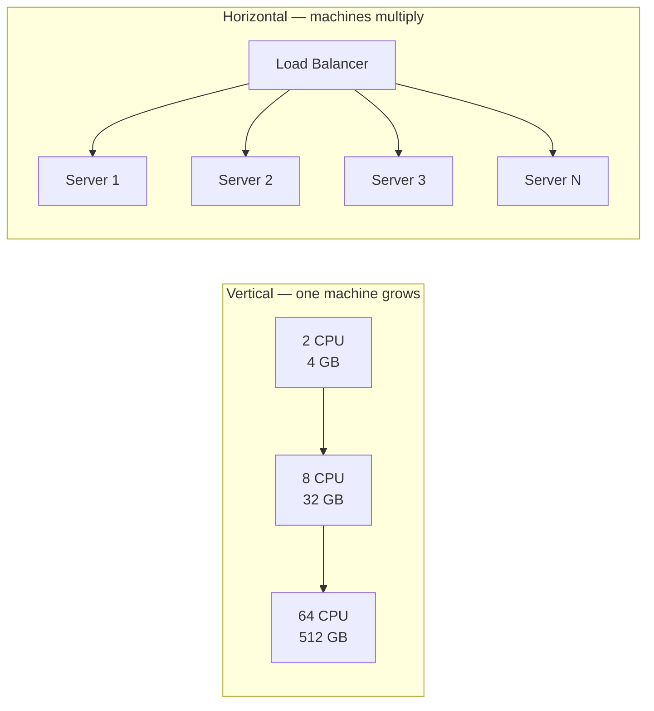

## Definition

**Scalability** is a system's ability to handle a growing amount of work by adding resources to it.
The emphasis is on *by adding resources*. A system that gets faster only when someone rewrites its code is being optimised, not scaled. A scalable system absorbs more load through a change in resources, not a change in logic.

Load is not constant. A product that serves a thousand requests a minute today may serve a hundred thousand next year, and ten times its average during one hour on a Friday night.
Rewriting the system each time demand moves is too slow and too risky. Scalability is the property that lets capacity be adjusted as an operational action — provision more, or provision less — rather than an engineering project.

### Scaling is two-directional

Growth gets the attention, but shrinking matters just as much. Cloud capacity is billed by the hour, so a system sized for its yearly peak wastes money during every hour that is not the peak.

**Elasticity** is the ability to scale in both directions automatically as demand moves. Scalability makes the capacity change possible; elasticity makes it happen without a human.

## How it works

There are exactly two ways to add capacity.

| | Vertical scaling ("scaling up") | Horizontal scaling ("scaling out") |
| --- | --- | --- |
| The move | Replace the machine with a bigger one | Add more machines beside it |
| Resource added | More CPU cores, RAM, faster disk | More whole servers |
| Reverse direction | Scaling down — smaller machine | Scaling in — remove machines |
| Application changes | Usually none | Often significant |
| Ceiling | The largest machine that can be bought | No hard ceiling |
| Effect on failure | One machine remains a single point of failure | Surviving machines absorb the load |



### Vertical scaling

The application does not know anything changed. The same process runs on the same operating system with the same code, simply with more resources beneath it.

This makes it the cheapest option in engineering time, and it is often the correct first answer. Its limits are physical and economic rather than technical.

- **A hard ceiling.** Cloud providers sell a largest instance. Once it is reached, there is nothing bigger to buy.
- **Non-linear cost.** Beyond commodity hardware, price rises faster than capacity. Twice the cores usually costs well over twice as much.
- **Downtime on resize.** Changing instance size typically requires a restart, so the change is not free operationally.
- **Failure is unchanged.** A bigger machine is still one machine. If it dies, everything dies with it.

### Horizontal scaling

Capacity is added by running more copies of the application and placing a **load balancer** in front of them to distribute incoming requests.

This removes the ceiling and adds redundancy at the same time, which is why almost every large system ends up here. The cost is that the application must be built to allow it.

### The precondition: statelessness

A server is **stateless** when it stores nothing between requests that a later request depends on. This is what makes horizontal scaling possible: if any server can answer any request, the load balancer is free to send a request anywhere.

Storing state in a server's own memory breaks that. The user's second request lands on a different machine, which has never heard of them.

```js
// STATEFUL — breaks the moment a second server exists.
// This map lives in one process's memory. Server 2 has its own, empty copy.
const sessions = new Map();

app.post("/login", (req, res) => {
  const sessionId = crypto.randomUUID();
  sessions.set(sessionId, { userId: req.body.userId });
  res.cookie("sid", sessionId).send({ ok: true });
});
```

```js
// STATELESS — state moved to a store every server can reach.
// Any instance can now serve any request, so instances become interchangeable.
app.post("/login", async (req, res) => {
  const sessionId = crypto.randomUUID();
  await redis.set(`sess:${sessionId}`, JSON.stringify({ userId: req.body.userId }), {
    EX: 86400, // expire after a day, so abandoned sessions clean themselves up
  });
  res.cookie("sid", sessionId).send({ ok: true });
});
```

The general rule: move state out of the process and into something shared — a cache, a database, or a signed token carried by the client.

### Why capacity does not double when servers do

Adding a second server rarely gives twice the throughput. Two effects get in the way.

- **The shared bottleneck.** Application servers usually share one database. Doubling them doubles the pressure on a resource that did not get any bigger, so the database becomes the new limit.
- **Coordination overhead.** Machines that must agree — on a lock, a leader, a cache invalidation — spend time talking instead of working, and that cost grows with the number of participants.

The practical consequence is that horizontal scaling is not a single decision. Scaling the stateless tier is straightforward; scaling the data tier underneath it is the harder problem, and it is where most of the real work lives.

### The usual progression

Most systems travel the same route, and each step is only taken when the previous one runs out.

1. **One machine.** Application and database together.
2. **Scale up.** Buy a bigger machine. Cheap, fast, no code changes.
3. **Separate the database.** Application and data now scale independently.
4. **Scale the application out.** Several stateless app servers behind a load balancer.
5. **Scale reads out.** Copies of the database serve read traffic.
6. **Scale writes out.** Split the data across machines so no single one holds all of it.

## Key terms

| Term | Plain-English meaning |
| --- | --- |
| Scalability | The ability to handle more work by adding resources |
| Vertical scaling (scale up) | Replacing a machine with a more powerful one |
| Horizontal scaling (scale out) | Adding more machines that share the work |
| Scaling down / scaling in | The reverse of each, releasing capacity when demand falls |
| Elasticity | Adjusting capacity automatically as demand changes |
| Node / instance | One running machine in a group of them |
| Load balancer | Distributes incoming requests across several identical servers |
| Stateless | Keeps nothing in local memory that a later request depends on |
| Sticky session | Load balancer setting that pins one user to one server |
| Linear scalability | Doubling the machines roughly doubles the capacity |
| Bottleneck | The one component that limits the whole system's throughput |
| Auto-scaling | Adding or removing instances automatically from a load signal |

## Trade-offs

| Choice | Buys you | Costs you |
| --- | --- | --- |
| Scale up | No code changes, no distributed complexity, immediate | A hard ceiling, non-linear cost, downtime to resize, unchanged failure risk |
| Scale out | No ceiling, redundancy, commodity hardware pricing | Statelessness required, load balancing, network hops, harder debugging |
| Stateless servers | Any instance serves any request; instances become disposable | Every session read becomes a network call to a shared store |
| Sticky sessions | Keeps existing in-memory state working | Uneven load, and a user's session dies with their server |
| Auto-scaling | Pays only for capacity in use, absorbs spikes | New instances take time to start, so sudden spikes still hurt |
| Fixed capacity at peak size | Predictable, always ready | Paid for continuously, mostly idle |

Scaling up and scaling out are not rivals. Real systems do both: scale each individual node up to a sensible size, then run many of them.

## In the wild

- **Stack Overflow** ran one of the web's busiest sites on a small number of deliberately powerful servers, showing how far careful vertical scaling and caching can go before scaling out is required.
- **Netflix** runs stateless services on cloud instances that auto-scale with viewing demand, which rises and falls sharply by region and time of day.
- **Cassandra** and **DynamoDB** were designed to scale out from the start, spreading data across nodes so that write capacity grows with the cluster.
- **Relational databases** such as PostgreSQL and MySQL are typically scaled up first, then given read replicas, because splitting writes across machines is the hardest step of all.

## When to use / avoid

**Scale up when**

- The load still fits, or nearly fits, on one machine.
- The application holds state in memory and cannot yet be made stateless.
- The bottleneck is a single-threaded or hard-to-distribute workload.
- Speed of response matters more than long-term headroom.

**Scale out when**

- The largest available machine is no longer comfortably ahead of demand.
- Downtime is unacceptable and redundancy is required.
- Traffic is spiky, and capacity needs to follow demand.
- Users are spread across regions and capacity must sit near them.

**Do neither yet when**

- The system is not under pressure. Unused capacity is pure cost.
- The bottleneck has not been measured. Adding machines to a slow query makes the query no faster.

## TL;DR

- **Scalability** is absorbing more work by adding resources rather than rewriting code.
- **Vertical** scaling makes one machine bigger: simple, immediate, but capped and still a single point of failure.
- **Horizontal** scaling adds machines behind a load balancer: uncapped and redundant, but it demands a stateless application.
- **Statelessness** is the precondition — local in-memory session state is what usually blocks scaling out.
- Capacity rarely scales linearly, because servers share a database and coordination costs grow.
- Scaling down is half the point; **elasticity** is what makes capacity follow demand in both directions.
- Measure the bottleneck first. Neither direction helps a system limited by something else.