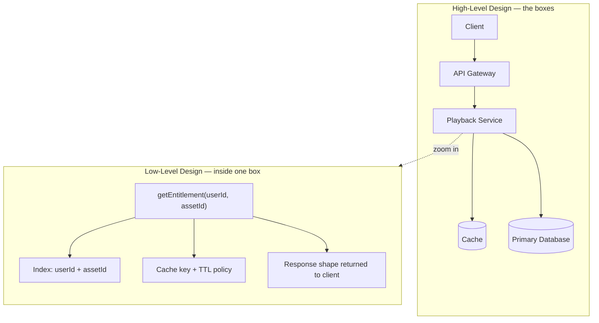

## Definition

**System design** is the practice of deciding how the parts of a software system — servers, databases, caches, queues, networks — are arranged and connected so the system meets its requirements at the scale it must actually run.
Writing code answers *does this function return the right value?* System design answers *does it still return the right value under a million users, on a bad network, when a machine dies?*

One machine can run an entire application: web server, database and all. That arrangement holds until users, data or hardware failures outgrow it.
The moment a second machine is added, **distance** appears. Calls now cross a network that is slower than memory, can drop messages, and can fail halfway. System design is the accumulated set of techniques for working with that distance instead of pretending it isn't there.

### When it becomes necessary

The need arrives at a threshold rather than gradually. Below it, growth is absorbed quietly by one machine and the cheapest fix is a bigger machine. Above it, the cheapest fix becomes a change to the arrangement itself — and that change is what system design is.
Three signals mark the crossing: the largest machine available is no longer comfortably ahead of demand, an outage now costs more than the redundancy that would have prevented it, or one slow component is degrading parts of the product unrelated to it.
A fourth trigger is irreversibility. Decisions such as how data is split across machines, or which component owns which data, become expensive to undo once live traffic depends on them, so they are worth designing before they are built.

## How it works

### The three pressures

Almost every design decision traces back to one of three growth pressures.

| Pressure | What breaks first | Typical response |
| --- | --- | --- |
| More users | CPU and memory on one machine | Add machines behind a load balancer |
| More data | One database can't store or scan it | Split the data across machines |
| Failure | One machine down means total outage | Keep redundant copies |

A **load balancer** is a component that receives incoming requests and distributes them across several identical servers.

### What actually gets decided

A design is a set of choices in roughly five categories.

- **Decomposition** — one deployable application, or several independent services?
- **Data** — which store holds what, and how is it split or replicated?
- **Communication** — direct request-and-response, or messages placed on a queue and handled later?
- **Placement** — where does each piece run geographically, and what sits close to users?
- **Failure behaviour** — what happens to the rest of the system when any one piece stops responding?

A **queue** is an intermediate buffer: the sender writes a message and moves on, and a separate worker reads and processes it later.

### Two altitudes: HLD and LLD

The same system is described at two zoom levels, and the words for them are standard.

| | High-Level Design (HLD) | Low-Level Design (LLD) |
| --- | --- | --- |
| Question answered | What are the boxes, and how do they connect? | What is inside one box? |
| Artifacts | Architecture diagram, data flow, technology choices | Class design, database schema, API contracts, algorithms |
| Unit of thought | Service, datastore, network hop | Function, table, index, object |
| Failure mode | Wrong shape — cannot scale, one component takes everything down | Right shape, faulty internals — race conditions, bad schema, wrong index |

<div />



HLD picks the shape. LLD makes that shape correct.

```js
// LLD: the contract for one box in the diagram above.
// Small, precise, and unconcerned with how many servers exist.
async function getEntitlement(userId, assetId) {
  const key = `ent:${userId}:${assetId}`;

  const cached = await cache.get(key);
  if (cached !== null) return JSON.parse(cached);

  // Compound index on { userId, assetId } keeps this a single lookup.
  const record = await db
    .collection("entitlements")
    .findOne({ userId, assetId }, { projection: { _id: 0, tier: 1, expiresAt: 1 } });

  const result = { allowed: Boolean(record) && record.expiresAt > Date.now() };

  // Short TTL: entitlement can be revoked, so staleness is bounded.
  await cache.set(key, JSON.stringify(result), { ttlSeconds: 60 });
  return result;
}
```

### How a design is judged

A design that produces correct output can still be a bad design. Two families of requirement apply.

- **Functional** — what the system does. *Play a video. Charge a card. Send a receipt.*
- **Non-functional** — how well it does it. *Start playback in under two seconds. Stay up 99.95% of the year. Survive the loss of one data centre.*

Non-functional requirements are what make system design hard, because they conflict with each other and with cost.

## Key terms

| Term | Plain-English meaning |
| --- | --- |
| High-Level Design (HLD) | The arrangement of major components and the connections between them |
| Low-Level Design (LLD) | The internal construction of a single component: schema, classes, algorithms |
| Component | Any independently running piece: a service, a database, a cache |
| Load balancer | Spreads incoming requests across several identical servers |
| Cache | A fast temporary store holding copies of data that is expensive to fetch |
| Queue | A buffer that lets a sender hand off work and let a worker handle it later |
| Latency | How long one request takes |
| Throughput | How many requests are handled per unit of time |
| Availability | The share of time the system is usable, often written as a run of nines |
| Single point of failure | A component whose failure takes the whole system down |
| Non-functional requirement | A quality target — speed, uptime, cost — rather than a feature |
| Distributed system | A system whose work is spread across machines that talk over a network |

## Trade-offs

| Choice | Buys you | Costs you |
| --- | --- | --- |
| One machine (monolith) | Simplicity, no network calls, easy debugging, low cost | A hard ceiling on capacity and a single point of failure |
| Many machines | Capacity beyond one box, redundancy | Network delay, partial failure, coordination, operational overhead |
| Copies of data in several places | Reads stay fast and survive a node loss | Copies can disagree; keeping them in step costs latency |
| Design for future scale now | Fewer painful rewrites later | Complexity paid for before it is needed, slower delivery today |
| Design for today only | Ships fastest, stays understandable | Rework when a pressure arrives |
| HLD before LLD | The shape is right before effort is spent inside it | Some internal constraints only surface late |

The last two rows are the reason system design is judgement rather than a recipe. There is no arrangement that wins on every axis.

## In the wild

- **Stack Overflow** ran a very high-traffic site on a deliberately small number of powerful servers, showing that a simple, well-tuned arrangement can carry far more load than the machine count suggests.
- **Amazon** moved from a single large application to independently deployed services in the early 2000s, trading simplicity for the ability to let teams ship without coordinating a shared release.
- **Netflix** places caching appliances inside internet service provider networks so video is served from near the viewer rather than from a distant origin — a placement decision, made purely at the high level.
- **Google Spanner** spends extra write latency, coordinated by synchronised clocks, to give strongly consistent transactions across regions — buying consistency with time.

## When to use / avoid

**Deliberate system design pays off when**

- Traffic or data is growing faster than a single machine can absorb.
- Downtime has a real cost — revenue, safety, contractual uptime.
- Several teams need to release independently.
- Users are spread across regions and physical distance is adding delay.
- A change would be expensive to reverse later, such as how data is split.

**It is usually overkill when**

- The user base is small and the load fits comfortably on one machine.
- The product is still searching for what it should do; the shape will change anyway.
- The added components would introduce more failure modes than they remove.
- Nobody is available to operate and monitor the extra moving parts.

## TL;DR

- System design is deciding how a system's parts are arranged so it meets its requirements at real scale.
- It exists because users, data and hardware failure eventually exceed what one machine can absorb.
- Adding machines introduces network distance: delay, partial failure and disagreeing copies of data.
- **HLD** defines the boxes and the connections; **LLD** defines what happens inside one box.
- Designs are judged on non-functional requirements — latency, availability, cost — not only on correct output.
- Every arrangement trades something away, so the goal is a defensible fit for the constraints, not a universally best answer.