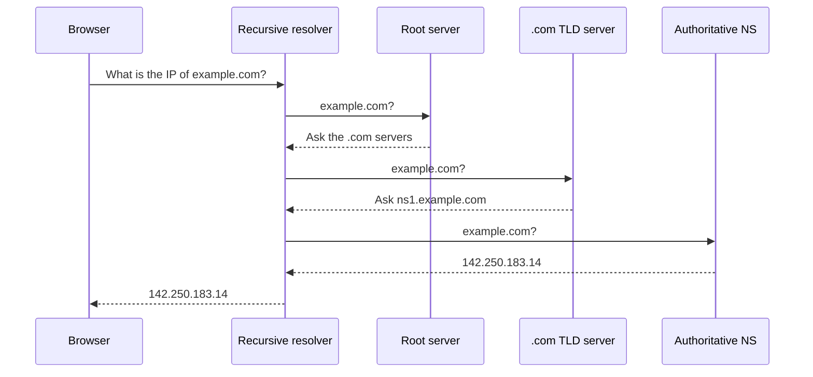

## Definition

An **IP address** is a numeric label that identifies a device on a network, such as `142.250.183.14`. Machines use it to know where to send data.

**DNS (Domain Name System)** is the internet's directory service. It translates a human-readable name like `example.com` into the IP address behind it.

---

## The problem it solves

IP addresses work for machines and fail for humans. Nobody memorises `142.250.183.14`, and the number changes whenever a service moves to different hardware.
A second problem is scale. A large service runs thousands of machines with thousands of addresses, and users need one stable name that points at whichever of them is closest and healthy.
DNS adds a layer of indirection: names stay fixed while the addresses underneath change freely.

---

## How it works

### IP addresses come in two versions

| Version | Example | Address space | Status |
|---|---|---|---|
| **IPv4** | `142.250.183.14` | ~4.3 billion | Dominant, exhausted |
| **IPv6** | `2001:db8:85a3::8a2e:370:7334` | ~340 undecillion | Growing, mandatory on mobile networks |

IPv4 uses four numbers from 0 to 255. IPv6 uses hexadecimal groups and exists because the IPv4 space ran out.

### Public and private addresses

Not every address is visible to the internet.

| Type | Unique across | Example | Reachable from internet |
|---|---|---|---|
| **Public** | The whole internet | `203.0.113.7` | Yes |
| **Private** | One local network | `192.168.1.5` | No |

Reserved private ranges: `10.0.0.0/8`, `172.16.0.0/12`, `192.168.0.0/16`. These repeat in millions of networks simultaneously, which is why routers on the public internet discard packets that carry them.

A device on a private address reaches the internet through **NAT (Network Address Translation)** — a gateway swaps the private source address for its own public one, then reverses the swap on the reply.

### A domain name is read right to left

```
        www  .  example  .  com  .
         │        │          │    │
         │        │          │    └─ Root (trailing dot, usually hidden)
         │        │          └────── TLD — Top-Level Domain
         │        └───────────────── Second-level domain (the registered name)
         └────────────────────────── Subdomain
```

Each level delegates authority to the level below it. The root knows the TLDs, a TLD knows its registered domains, and a domain knows its own hosts.

### Four server roles

DNS is not one server. It is four kinds, each holding one narrow piece of knowledge.

| Server | Knows | Answers with |
|---|---|---|
| **Recursive resolver** | Nothing permanently — it does the asking | The final answer, after querying the others |
| **Root server** | Where TLD servers live | "Ask the `.com` servers" |
| **TLD server** | Which nameserver owns each domain | "Ask `ns1.example.com`" |
| **Authoritative nameserver** | The real records for its domain | `142.250.183.14` |

The **recursive resolver** does the legwork. It is usually operated by an internet provider, or by a public service such as `1.1.1.1` or `8.8.8.8`.

No single machine stores every domain on earth. Each layer stores only a pointer to the next one, which is what lets the system scale and stay decentralised.

### The resolution chain



The browser asks one question and receives one answer. The chain behind it is invisible.

Once the address is known, DNS is finished. The browser opens a direct connection to that IP, and DNS carries none of the actual traffic.

### Caching stops most of this from happening

The full chain runs rarely. Four caches are checked in order first, and a hit at any level ends the lookup.

| Cache | Location | Typical latency |
|---|---|---|
| Browser cache | The application itself | ~0 ms |
| OS cache | The operating system's resolver | ~0 ms |
| Router cache | The local gateway | ~1 ms |
| Resolver cache | The provider's resolver | ~5–20 ms |
| **Full recursive walk** | **All four server roles** | **~50–200 ms** |

### TTL controls how long an answer is cached

Every DNS record carries a **TTL (Time To Live)** in seconds. When it expires, caches discard the answer and ask again.

```
example.com.   300   IN   A   142.250.183.14
               ^^^
               TTL in seconds — this answer is valid for 5 minutes
```

Lowering the TTL a day before a planned server migration means the change propagates in minutes rather than hours.

### Record types

A domain does not store a single value. It stores a set of typed records.

| Record | Maps a name to | Used for |
|---|---|---|
| **A** | An IPv4 address | Standard hostname lookup |
| **AAAA** | An IPv6 address | IPv6 hostname lookup |
| **CNAME** | Another domain name | Aliases, pointing at a CDN hostname |
| **MX** | A mail server | Email delivery |
| **NS** | Authoritative nameservers | Delegating a zone |
| **TXT** | Arbitrary text | Domain ownership proof, email anti-spoofing |

An **A** record ends the lookup. A **CNAME** points at another name, which needs its own resolution — so chained aliases add round trips.

```js
// Node.js resolves names through the OS resolver by default
const dns = require('node:dns').promises;

const addresses = await dns.resolve4('example.com');
// [ '142.250.183.14' ]

const records = await dns.resolveMx('example.com');
// [ { priority: 10, exchange: 'mail.example.com' } ]
```

---

## Key terms

| Term | Plain-English meaning |
|---|---|
| **IP address** | A number identifying a device on a network |
| **IPv4 / IPv6** | The two address formats; IPv6 exists because IPv4 ran out |
| **Public IP** | An address reachable from anywhere on the internet |
| **Private IP** | An address meaningful only inside one local network |
| **NAT** | Rewriting a private source address to a public one so replies can return |
| **TLD** | The last part of a domain, such as `.com` or `.in` |
| **Recursive resolver** | The server that performs the lookup on a client's behalf |
| **Authoritative nameserver** | The server holding the real records for a domain |
| **TTL** | How many seconds a cached DNS answer stays valid |
| **A record** | A name-to-IPv4-address mapping |
| **CNAME** | A name-to-another-name mapping |
| **Propagation** | The delay before a DNS change is visible everywhere, bounded by TTL |

---

## Trade-offs

| Choice | Buys you | Costs you |
|---|---|---|
| **Low TTL** (30–300s) | Fast failover, quick migrations | More lookups, higher resolver load, slower average lookup |
| **High TTL** (24h) | Fewer lookups, faster average response | Changes take up to a day to reach every cache |
| **A record** | One lookup, direct answer | Must update the record whenever the IP changes |
| **CNAME** | Target can change its IP freely | An extra lookup per level of aliasing |
| **Single authoritative provider** | Simpler operations | That provider becomes a single point of failure |
| **Multiple providers** | Survives one provider's outage | Records must stay synchronised across both |
| **Aggressive caching everywhere** | Lowest latency | Stale answers linger after a change |

---

## In the wild

- **Dyn outage, 2016** — an attack on one DNS provider made Twitter, Reddit and Spotify unreachable, even though those services were running normally. Many large operators now use two independent DNS providers.
- **CDNs** answer the same name with different addresses depending on where the query came from, steering each user to a nearby edge server.
- **Mobile carriers** run IPv6 widely because assigning public IPv4 addresses to every handset is impossible, and large-scale NAT is expensive to operate.
- **Cloudflare's `1.1.1.1` and Google's `8.8.8.8`** are public recursive resolvers that many users configure instead of their provider's, usually for speed or filtering behaviour.

---

## When to reach for each option

**Use a low TTL when**

- A migration or cutover is planned within the next day
- The record participates in failover between healthy and unhealthy hosts
- The address is expected to change often

**Use a high TTL when**

- The record is stable and rarely edited, such as an MX record
- Query volume is high and resolver load matters
- Nothing downstream depends on rapid change

**Avoid a CNAME when**

- It sits at the root of a domain — most DNS standards disallow this
- Latency is critical and the extra lookup is measurable
- The chain would run more than one level deep

---

## TL;DR

- An **IP address** identifies a machine; **DNS** translates a name into that address.
- **Private addresses** repeat across networks and reach the internet through **NAT**; **public addresses** are globally unique.
- A domain resolves **right to left**: root → TLD → authoritative nameserver.
- The **recursive resolver** performs the chain; the browser sees only the final answer.
- **Caching** at browser, OS, router and resolver means the full chain rarely runs.
- **TTL** trades propagation speed against lookup volume — lower it before a migration.
- **A** records point at addresses; **CNAME** records point at names and cost an extra lookup.
- DNS returns an address and then steps aside — it never carries application traffic.