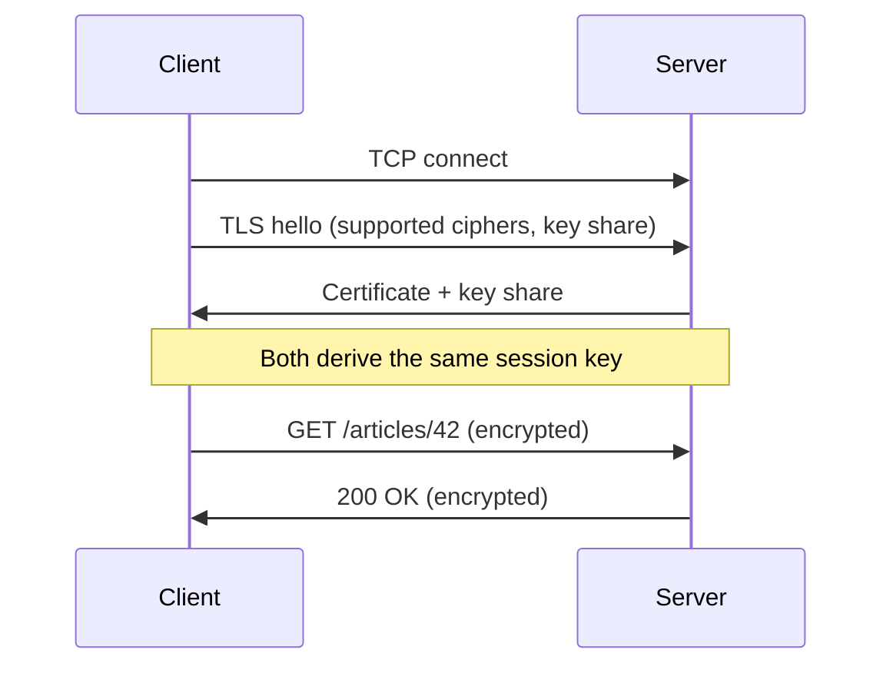

## Definition

**HTTP (HyperText Transfer Protocol)** is the set of rules a client uses to ask a server for something, and the server uses to answer. **HTTPS** is the same HTTP, sent inside an encrypted connection that also proves the server is who it claims to be.

## The problem it solves

A network can move bytes between two machines, but bytes alone carry no meaning. HTTP gives them a shared format: what is being asked, for which resource, and what came back. HTTPS adds protection, because every message passes through many routers and networks that could otherwise read or change it.

## How it works

### 1. Where HTTP sits

```
HTTP  →  WHAT is being asked         GET /articles/42
TLS   →  lock the message (HTTPS)    encryption + identity
TCP   →  deliver bytes reliably      ordered, nothing lost
IP    →  route to an address         203.0.113.10
```

Each layer does one job. HTTP never deals with lost packets; the transport layer underneath handles that.

- **Client**: the program that sends the request, such as a browser or a mobile app.
- **Server**: the program that receives the request and replies.
- **TCP (Transmission Control Protocol)**: delivers a stream of bytes in order, resending anything lost.
- **TLS (Transport Layer Security)**: encrypts the bytes and verifies the server's identity.

### 2. Three core properties

| Property | Meaning |
|---|---|
| Request–response | The client always speaks first. The server only replies. |
| Stateless | Each request stands alone. The server keeps no memory of earlier ones. |
| Text-based (HTTP/1.1) | Messages are human-readable. HTTP/2 and HTTP/3 switch to binary but keep the same meaning. |

### 3. Anatomy of a URL

```
https://example.com:443/articles/42?lang=en#comments
└─┬─┘   └────┬────┘ └┬┘ └────┬────┘ └──┬──┘ └───┬───┘
scheme     host    port    path     query  fragment
```

| Part | Role |
|---|---|
| Scheme | Which protocol: `http` (plain) or `https` (encrypted) |
| Host | Which website |
| Port | Which "door" on the machine. Defaults: `80` for HTTP, `443` for HTTPS |
| Path | Which resource on that site |
| Query | Extra parameters after `?`, as `key=value` pairs |
| Fragment | A spot within the page, after `#`. Never sent to the server |

### 4. Anatomy of a message

Every HTTP message has four parts, in this order:

```
1. Start line   → what this message is
2. Headers      → metadata, one "Name: value" per line
3. Blank line   → marks the end of headers
4. Body         → the data itself (optional)
```

**Request:**

```http
GET /articles/42?lang=en HTTP/1.1
Host: example.com
Accept: text/html
Accept-Encoding: gzip, br
Cookie: session=abc123

```

The start line holds three things: the **method** (what to do), the **path** (which resource) and the **version** (which rulebook both sides follow). `Host` names the website, because one server machine often hosts many sites behind a single address. It is the only header HTTP/1.1 requires.

**Response:**

```http
HTTP/1.1 200 OK
Content-Type: text/html; charset=utf-8
Content-Encoding: gzip
Content-Length: 5120
Cache-Control: max-age=60

<!doctype html>
...
```

The start line here is the **status line**: version, a numeric **status code**, and a short human-readable reason.

**How the reader knows where the body ends.** TCP is one continuous stream of bytes with no message boundaries, so HTTP must mark the end:

| Header | How it works |
|---|---|
| `Content-Length: 5120` | Read exactly this many bytes. |
| `Transfer-Encoding: chunked` | The body arrives in pieces, each prefixed with its size. A zero-size piece means "done". Used when the size isn't known up front, such as streamed responses. |

HTTP/1.1 really is plain text over a socket:

```js
// Raw HTTP/1.1 over a bare TCP connection — no HTTP library involved
const net = require('net');

const socket = net.connect(80, 'example.com', () => {
  // Lines end with \r\n; an empty line ends the headers
  socket.write('GET / HTTP/1.1\r\nHost: example.com\r\nConnection: close\r\n\r\n');
});

socket.on('data', (chunk) => process.stdout.write(chunk.toString()));
```

### 5. Methods

| Method | Meaning | Safe | Idempotent |
|---|---|---|---|
| `GET` | Read a resource | ✅ | ✅ |
| `HEAD` | Same as GET, headers only, no body | ✅ | ✅ |
| `OPTIONS` | Ask which methods are allowed (used by browsers for CORS pre-checks) | ✅ | ✅ |
| `POST` | Create something new, or trigger an action | ❌ | ❌ |
| `PUT` | Replace a resource entirely | ❌ | ✅ |
| `PATCH` | Change part of a resource | ❌ | ⚠️ depends |
| `DELETE` | Remove a resource | ❌ | ✅ |

- **Safe**: does not change anything on the server. Read-only.
- **Idempotent**: sending it once or ten times leaves the server in the same end state. A second `DELETE` may return `404`, but the resource is still gone, so it counts.
- **PATCH depends** on the change: "set email to X" is idempotent, "add 1 to counter" is not.

**Why idempotency matters: retries.** When a connection drops mid-request, the client can't tell whether the server received it. Idempotent requests can simply be resent; a resent `POST` might create a duplicate order or charge a card twice.

The standard fix is an **idempotency key**: a unique ID the server uses to detect repeats.

```js
// Generate the key once; reuse the same key on every retry
const idempotencyKey = crypto.randomUUID();

await fetch('/api/payments', {
  method: 'POST',
  headers: {
    'Content-Type': 'application/json',
    'Idempotency-Key': idempotencyKey, // server processes this key only once
  },
  body: JSON.stringify({ amount: 499 }),
});
```

### 6. Status codes

The first digit gives the family:

| Family | Meaning |
|---|---|
| **1xx** | Informational: keep going |
| **2xx** | Success |
| **3xx** | Redirection: look elsewhere |
| **4xx** | Client error: the request is wrong |
| **5xx** | Server error: the server failed |

Common codes:

| Code | Meaning |
|---|---|
| `101 Switching Protocols` | Upgrading the connection, for example to a WebSocket |
| `200 OK` | Success, body included |
| `201 Created` | A new resource was created |
| `204 No Content` | Success, nothing to send back |
| `206 Partial Content` | Only the requested byte range, used for video and resumable downloads |
| `301 Moved Permanently` | The resource has a new permanent URL |
| `302 Found` | Temporarily at another URL |
| `304 Not Modified` | The client's cached copy is still valid; no body sent |
| `400 Bad Request` | The request is malformed |
| `401 Unauthorized` | Not authenticated: the server doesn't know who you are |
| `403 Forbidden` | Authenticated, but not allowed |
| `404 Not Found` | No such resource |
| `429 Too Many Requests` | Rate limit exceeded |
| `500 Internal Server Error` | Unexpected failure on the server |
| `502 Bad Gateway` | A proxy got an invalid reply from the server behind it |
| `503 Service Unavailable` | Overloaded or down for maintenance |
| `504 Gateway Timeout` | A proxy gave up waiting for the server behind it |

A **proxy** is a server that sits in the middle and forwards requests, such as a load balancer. `502` and `504` describe a problem *behind* the proxy, not the proxy itself.

**Retry rules that follow from this:**

| Response | Retry? |
|---|---|
| `4xx` | No. Resending the same wrong request won't help. |
| `429` | Yes, after waiting (often told by a `Retry-After` header). |
| `5xx` on an idempotent method | Yes. |
| `5xx` on `POST` | Only with an idempotency key. |

### 7. Headers

**Headers** are `Name: value` pairs of metadata. They let two parties agree on details (format, compression, identity, caching) without guessing. Most of them work as a negotiation:

| Client sends | Server answers |
|---|---|
| `Accept: text/html` (formats I can read) | `Content-Type: text/html` (format I sent) |
| `Accept-Encoding: gzip, br` (compression I can undo) | `Content-Encoding: gzip` (compression I used) |
| `Accept-Language: en-US,en;q=0.9` | `Content-Language: en-US` |
| `Connection: keep-alive` (keep the line open) | `Keep-Alive: timeout=5` (for up to 5 idle seconds) |
| `Cookie: session=abc123` | `Set-Cookie: session=abc123; HttpOnly` |

`q` is a preference weight from 0 to 1. A value without `q` counts as 1, the top preference.

**Caching headers** decide whether a response can be reused:

| Header | Meaning |
|---|---|
| `Cache-Control: max-age=60` | Reuse this copy for 60 seconds without asking. |
| `Cache-Control: no-cache` | A copy may be stored, but must be checked with the server before each reuse. |
| `Cache-Control: no-store` | Never store a copy. |
| `ETag: "v7"` | A version label. The client sends it back in `If-None-Match`; an unchanged resource gets `304`. |
| `Vary: Accept-Encoding` | This response differs by that request header; caches must not hand it to clients that sent a different value. |

Apps can also define **custom headers**. The old convention of prefixing them with `X-` (as in `X-Request-Id`) is officially discouraged but still widespread.

### 8. Statelessness, and how servers remember users

HTTP forgets every request once it is answered. This is deliberate:

| Stateful server | Stateless server |
|---|---|
| Only the server that holds your data can answer you | Any server can answer any request |
| A crash loses in-memory sessions | A crash loses nothing |
| A **load balancer** (the component spreading traffic across servers) must pin each user to one server | Traffic can go anywhere |
| Hard to add servers | Add servers freely |

Apps still need memory (logins, carts, settings). The solution: **the client carries proof of state on every request**, and the server stays forgetful.

| | Session ID | Signed token (e.g. JWT) |
|---|---|---|
| What the client holds | A random ID | The facts themselves plus a signature |
| Where the facts live | A shared store (database, Redis) | Inside the token |
| Server work per request | Look up the ID | Verify the signature, no lookup |
| Instant logout | Easy: delete the entry | Hard: valid until it expires |
| Size | Tiny | Larger |

A **JWT (JSON Web Token)** is base64-encoded JSON plus a signature. **Base64 is encoding, not encryption**: anyone can decode and read the contents. The signature only proves nobody changed them, so tokens must never contain passwords or secrets.

**Cookies are the delivery method, not the contents.** A cookie can hold a session ID or a token; a token can also travel in an `Authorization: Bearer ...` header instead.

```
Server reply:    Set-Cookie: session=abc123; HttpOnly; Secure; SameSite=Lax; Max-Age=86400
                        ↓  browser stores it
Every request:   Cookie: session=abc123       (sent automatically, to that site only)
```

| Attribute | Effect | Protects against |
|---|---|---|
| `HttpOnly` | Page JavaScript can't read the cookie | Scripts injected into the page stealing it (XSS) |
| `Secure` | Sent only over HTTPS | Network eavesdroppers |
| `SameSite` | Not sent when another site triggers the request | Other sites acting as the user (CSRF) |
| `Max-Age` / `Expires` | Sets a lifetime | Sessions that never end |

### 9. HTTP versions

The meaning of HTTP (methods, paths, status codes, headers) has never changed. Each version changes only **how messages travel**.

**HTTP/1.0 → HTTP/1.1: reuse the connection**

```
1.0:  connect → request → response → close   (repeat for every file)
1.1:  connect → request → response → request → response → ...
```

HTTP/1.1 keeps connections open (`keep-alive`), but each connection handles one request at a time. A slow response blocks everything queued behind it: **head-of-line blocking**. Browsers work around this by opening about six connections per site.

**HTTP/2: many streams on one connection**

```
One TCP connection, requests A, B, C interleaved as labelled frames:
[A1][B1][C1][A2][C2][B2][A3]  →  receiver reassembles by label
```

- **Multiplexing**: many requests share one connection without waiting for each other.
- **Binary framing** instead of text.
- **Header compression (HPACK)**: repeated headers such as cookies aren't resent in full.
- The start line and `Host` become pseudo-headers: `:method`, `:path`, `:scheme`, `:authority`. Connection-level headers like `Connection: keep-alive` are forbidden.

The catch: TCP still delivers bytes strictly in order. One lost packet stalls **every** stream on the connection until it is resent.

```
[A1][B1] ✗ lost [A2][C2][B2]   →  A, B and C all wait
```

**HTTP/3: independent streams over QUIC**

HTTP/3 replaces TCP with **QUIC**, a transport built on **UDP** (a minimal protocol that sends packets with no ordering or delivery guarantees). QUIC adds reliability itself, but per stream.

```
Stream A: [A1][A2][A3]
Stream B: [B1]  ✗  [B3]   ←  only B waits
Stream C: [C1][C2]
```

- A lost packet stalls only its own stream.
- TLS 1.3 is built in, so connection setup takes fewer round trips.
- **Connection migration**: a connection survives switching networks (Wi-Fi to mobile), because it is identified by an ID rather than the client's IP address.
- QUIC is built on UDP because TCP lives inside operating systems and network hardware, where changes take decades to spread.

| Version | Year | Fixed | Still limited by |
|---|---|---|---|
| HTTP/1.0 | 1996 | — | A new connection per request |
| HTTP/1.1 | 1997 | Persistent connections | One request at a time per connection |
| HTTP/2 | 2015 | Multiplexing, header compression | TCP head-of-line blocking |
| HTTP/3 | 2022 | Independent streams, faster setup, migration | Some networks block UDP (clients fall back to HTTP/2) |

**How a client picks a version:** HTTP/2 is agreed during the TLS handshake (a step called **ALPN**). For HTTP/3, a server advertises support with a header such as `Alt-Svc: h3=":443"`, and the client switches on later connections.

### 10. HTTPS

Plain HTTP travels as readable text through every router, Wi-Fi access point and network on the path. HTTPS wraps the same messages in TLS.

| Guarantee | Meaning | Stops |
|---|---|---|
| **Confidentiality** | Only the two endpoints can read the messages | Eavesdropping (e.g. stealing a session cookie) |
| **Integrity** | Any change in transit is detected | Injecting ads or malware |
| **Authentication** | The server proves its identity with a certificate | Impersonation by a fake server |



- **Certificate**: a document binding a domain name to a public key, signed by a **Certificate Authority (CA)**. Browsers ship with a list of CAs they trust.
- **Two kinds of keys**: slow public-key cryptography is used only to agree on a shared secret; fast symmetric encryption then protects all the data.

**What HTTPS hides and what it doesn't:**

| Encrypted | Still visible on the network |
|---|---|
| Method, path and query | Server IP address and port |
| All headers, including cookies | Domain name (usually) |
| Request and response bodies | Timing and approximate data size |
| Status code | |

**Related mechanisms:**

- **HTTP → HTTPS redirect**: servers answer plain `http://` requests with `301` to the `https://` URL.
- **HSTS**: `Strict-Transport-Security: max-age=31536000` tells the browser to use only HTTPS for this site for a year, blocking downgrade attacks.
- **TLS termination**: a load balancer or reverse proxy decrypts traffic at the edge and forwards it to internal servers, so each backend doesn't manage certificates.
- **Localhost exception**: browsers treat `localhost` as a secure context, so local development over plain HTTP still works.

## Key terms

| Term | Plain-English meaning |
|---|---|
| Request / Response | The message a client sends / the message a server sends back |
| Method | The action requested: GET, POST, PUT, PATCH, DELETE |
| Path | Which resource on the server |
| Header | A `Name: value` line of metadata |
| Body | The data carried by a message |
| Status code | A three-digit number summarising the outcome |
| Safe method | A method that only reads and changes nothing |
| Idempotent | Repeating the request leaves the same end state |
| Stateless | The server keeps no memory between requests |
| Cookie | Small data the browser stores and sends back automatically |
| Session ID | A random ID pointing to user data stored on the server side |
| JWT | A signed token that carries user data inside itself |
| Keep-alive | Reusing one connection for several requests |
| Head-of-line blocking | One slow or lost item holding up everything behind it |
| Multiplexing | Running many requests over one connection at once |
| QUIC | The UDP-based transport underneath HTTP/3 |
| TLS | The encryption and identity layer that turns HTTP into HTTPS |
| Certificate Authority | A trusted organisation that signs certificates |
| HSTS | A header telling browsers to always use HTTPS for a site |

## Trade-offs

| Choice | Buys you | Costs you |
|---|---|---|
| Stateless servers | Any server handles any request; easy horizontal scaling | Every request must carry its own context |
| Session ID | Tiny cookie, instant revocation | A shared-store lookup on every request |
| Signed token (JWT) | No lookup; works across services | Hard to revoke early; larger; contents readable |
| `Content-Length` | Simple; progress bars possible | Size must be known before sending |
| Chunked encoding | Streaming as data becomes ready | No total size up front |
| HTTP/1.1 | Simple, human-readable, universally supported | One request at a time per connection |
| HTTP/2 | Multiplexing on one connection, compressed headers | TCP packet loss stalls all streams |
| HTTP/3 | Independent streams, faster setup, survives network changes | UDP sometimes blocked; heavier CPU use in user space |
| HTTPS | Privacy, integrity, server identity; required for HTTP/2 in browsers | Certificate management; a small handshake cost |

## In the wild

- **Stripe** accepts an `Idempotency-Key` header on POST requests so clients can safely retry payments.
- **Google** developed QUIC, which became the basis of HTTP/3, and serves most of its traffic, including YouTube, over it.
- **Let's Encrypt** issues free, automatically renewed certificates, which made HTTPS the default across the web.
- **Chrome** ships an HSTS preload list: domains on it are never loaded over plain HTTP, even on the first visit.

## When to use / avoid

**Plain request–response HTTP fits well for:**

- Reading and changing resources (pages, APIs, files)
- Content that benefits from caching, including CDNs
- Public APIs that any client should be able to call

**Look elsewhere when:**

- Both sides need to push messages at any time (chat, live collaboration) → WebSockets
- Internal service-to-service calls need strict contracts and speed → gRPC (which runs over HTTP/2)
- Sending anything sensitive over plain HTTP → always use HTTPS instead

## TL;DR

- HTTP is a request–response protocol: method + path + headers + body in, status + headers + body out.
- It is stateless by design, so any server can answer any request; cookies and tokens carry user state instead.
- Idempotent methods (GET, PUT, DELETE) are safe to retry; POST needs an idempotency key.
- Status code families: 2xx success, 3xx redirect, 4xx client error, 5xx server error.
- HTTP/1.1 → 2 → 3 keeps the same meaning while fixing head-of-line blocking: persistent connections, then multiplexing, then independent streams over QUIC.
- HTTPS wraps HTTP in TLS for confidentiality, integrity and server authentication.