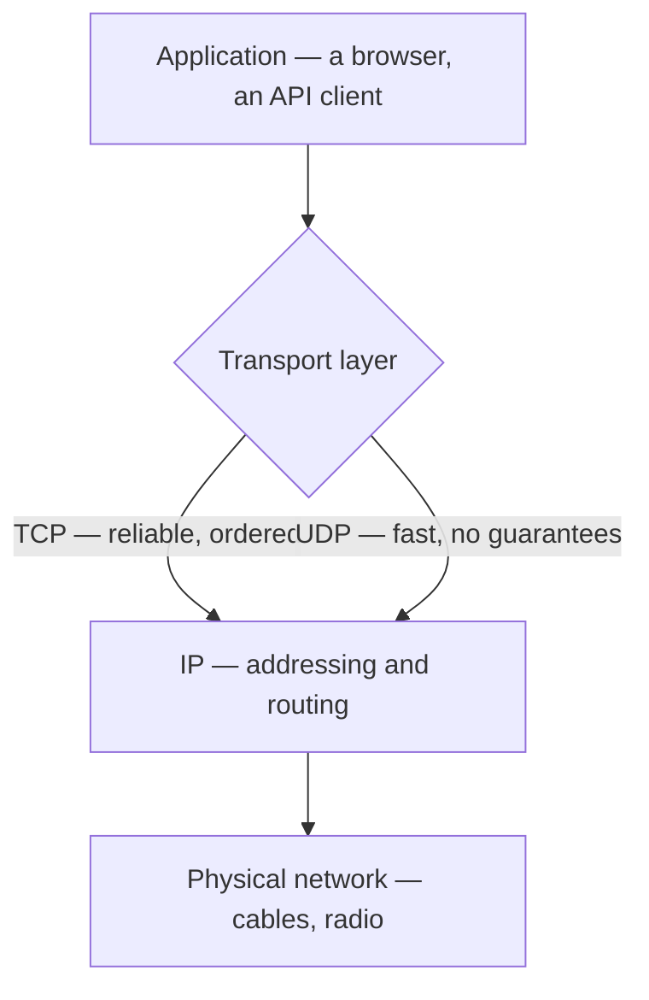
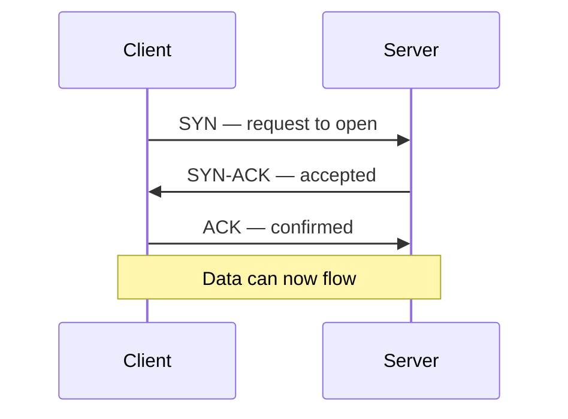

## Definition

**Packet switching** is the practice of splitting data into small, independently routed chunks called packets, then reassembling them at the destination.

**TCP** and **UDP** are the two transport protocols that sit on top of packet switching. TCP guarantees that every packet arrives, in order. UDP sends packets once and never checks.

---

## The problem it solves

A network link is shared by millions of users, so no single conversation can own a wire end to end. Packet switching lets everyone interleave on the same infrastructure, and lets traffic route around a failed link.

The cost is unreliability. **IP**, the protocol that addresses and routes packets, is *best-effort*: it attempts delivery and guarantees nothing.

| What can go wrong | Why |
|---|---|
| Packet lost | A router's queue was full and it dropped the packet |
| Packets reordered | Packet 3 took a faster path than packet 2 |
| Packet duplicated | A retransmission raced the original |
| Packet delayed | A congested route added hundreds of milliseconds |

TCP and UDP are two different answers to that list.

---

## How it works

### Packet switching vs circuit switching

```
CIRCUIT SWITCHING (old telephone networks)
  A ═══════════ dedicated path, reserved ═══════════ B
  Wasted when idle. One failure kills the call.

PACKET SWITCHING (the internet)
  A ──[1]──┐        ┌──[1]──> B
           ├ router ┤
  A ──[2]──┘        └──[2]──> B   (may take a different path)
  Shared by everyone. Routes around failures.
```

Each packet carries its own destination address, so routers forward it independently. Packets from one file may arrive out of order, or not at all.

### Where transport protocols sit



### Ports and sockets

An IP address identifies a *machine*. A **port number** identifies a *process* on that machine.

A connection is uniquely identified by four values, called the 4-tuple:

```
source IP : source port  →  destination IP : destination port
203.0.113.9 : 51884      →  198.51.100.4 : 443
```

Because the source port differs for every connection, one server can hold hundreds of thousands of simultaneous connections on a single port such as 443.

### TCP: the reliable protocol

TCP opens a connection before any data moves, using a **3-way handshake**.



Once open, five mechanisms keep the guarantees:

| Mechanism | What it does |
|---|---|
| Sequence numbers | Numbers every byte so the receiver can reorder |
| Acknowledgements (ACKs) | Receiver confirms what it received |
| Retransmission | No ACK within a timeout means the sender resends |
| Flow control | Stops the sender outpacing the receiver's buffer |
| Congestion control | Slows the sender when the network shows signs of overload |

Closing is a separate 4-step exchange (FIN, ACK, FIN, ACK). The socket then sits in a `TIME_WAIT` state for up to a couple of minutes, which is why servers cycling many short connections can exhaust their available ports.

### Head-of-line blocking

TCP's ordering guarantee has a specific cost. If packet 2 is lost, packets 3, 4 and 5 sit in a buffer until 2 is resent, even though they arrived safely.

```
Received:  [1] [ X ] [3] [4] [5]
                 ↑
           lost — 3, 4, 5 wait here, unusable
```

One missing packet stalls everything behind it.

### UDP: the minimal protocol

UDP adds almost nothing to IP. No handshake, no acknowledgements, no retransmission, no ordering.

| | TCP header | UDP header |
|---|---|---|
| Minimum size | 20 bytes | 8 bytes |
| Contains | Sequence numbers, ACK numbers, window size, flags | Source port, destination port, length, checksum |

A lost UDP packet is simply gone. Any application that cares must handle it itself, usually by numbering messages and skipping over gaps.

UDP also supports **multicast**: one packet delivered to many receivers at once. TCP is strictly one-to-one and cannot do this.

### Packet size and fragmentation

Most network links carry about 1500 bytes per packet, a limit called the **MTU** (Maximum Transmission Unit).

- **TCP** splits a data stream to fit the MTU automatically. The application never sees this.
- **UDP** sends whatever it is given. An oversized datagram is fragmented across several packets, and losing any one fragment discards the entire datagram.

This is why UDP payloads are usually kept small, often under roughly 1200 bytes.

### Framing: a practical difference

TCP delivers a continuous **stream of bytes** with no message boundaries. Two sends of 100 bytes may arrive as one 200-byte read, or as reads of 30 and 170.

UDP preserves boundaries: one send produces exactly one receive.

```js
// TCP — boundaries must be added by the application.
// Here each message ends with a newline.
let buffer = '';

socket.on('data', (chunk) => {
  buffer += chunk.toString();
  let i;
  while ((i = buffer.indexOf('\n')) !== -1) {
    const message = JSON.parse(buffer.slice(0, i));
    buffer = buffer.slice(i + 1);
    handle(message);
  }
});
```

```js
// UDP — one datagram in, one datagram out. No framing needed.
socket.on('message', (datagram) => {
  handle(JSON.parse(datagram));
});
```

Forgetting TCP framing is a common source of bugs that only appear under load, when packets begin to coalesce.

### QUIC: reliability rebuilt on UDP

**QUIC** is a newer transport protocol that runs on UDP and implements ordering, retransmission and encryption itself. It is the foundation of **HTTP/3**.

Its main gain is per-stream reliability. A lost packet stalls only the stream it belongs to, rather than every stream sharing the connection, which removes TCP's head-of-line blocking. It also merges the transport and encryption handshakes, so a connection can be established in fewer round trips.

---

## Key terms

| Term | Plain-English meaning |
|---|---|
| Packet | A small chunk of data with an address attached |
| Packet switching | Splitting data into independently routed packets |
| IP | The protocol that addresses and routes packets, with no delivery guarantee |
| Transport layer | The layer above IP that decides what to do about loss and ordering |
| Port | A number identifying which process on a machine should receive the data |
| Socket | One endpoint of a connection, identified by an IP and port pair |
| Handshake | The opening exchange that establishes a TCP connection |
| ACK | A message confirming that data was received |
| Sequence number | A counter letting the receiver reorder and detect gaps |
| Head-of-line blocking | Later packets waiting on an earlier lost one |
| MTU | The largest packet size a network link accepts, typically about 1500 bytes |
| Datagram | A single self-contained UDP message |
| Multicast | One packet delivered to many receivers at once |
| RTT | Round-trip time: how long a message takes to reach a peer and come back |
| QUIC | A transport protocol on UDP that supplies reliability per stream |

---

## Trade-offs

| Choice | Buys you | Costs you |
|---|---|---|
| **TCP** | Guaranteed, ordered delivery; loss handled by the operating system | One round trip before data flows; head-of-line blocking; larger headers |
| **UDP** | No setup delay; small headers; multicast; loss cannot stall the stream | No delivery or ordering guarantees; the application must handle gaps |
| **QUIC** | Per-stream reliability; faster connection setup; encryption included | Younger ecosystem; more CPU per packet; some networks throttle UDP |

The deciding question is rarely "reliable or fast". It is: **is late data still useful?**

- Yes, the data must be complete whenever it arrives → TCP.
- No, a stale update has already been replaced → UDP.

---

## In the wild

- **HLS and DASH video streaming** deliver segments over HTTP, so over TCP. A segment is a file, and a missing byte corrupts it, so reliability wins and a few seconds of buffering hides the delay.
- **Video conferencing** (Zoom, Google Meet, WebRTC) uses UDP. A frame from two seconds ago has no value, so retransmitting it would only add delay.
- **DNS** uses UDP for ordinary lookups: one small question, one small answer, where a handshake would double the cost. It falls back to TCP for responses too large for a single datagram.
- **Google, Meta and Cloudflare** serve large shares of their traffic over HTTP/3, that is QUIC over UDP, mainly to avoid head-of-line blocking on lossy mobile networks.

---

## When to use / avoid

**Use TCP when**

- Every byte must arrive: files, API responses, database queries, page loads
- Order matters: chat messages, collaborative document edits, event logs
- Connections are long-lived, so handshake cost is amortised

**Use UDP when**

- Only the newest value matters: player positions, live cursors, sensor readings
- Latency matters more than completeness: voice, live video, gaming
- Exchanges are tiny and one-shot, where a handshake would dominate the cost
- One message must reach many receivers at once

**Avoid UDP when** the application cannot tolerate gaps and has no plan for detecting them. Rebuilding reliability by hand tends to reproduce TCP, more slowly and with more bugs.

---

## TL;DR

- Packet switching splits data into independently routed packets, which makes networks shareable and resilient but unreliable.
- IP is best-effort, so packets may be lost, reordered, duplicated or delayed.
- TCP restores order and completeness with a handshake, sequence numbers, ACKs, retransmission, and flow and congestion control.
- The price of TCP is one round trip of setup and head-of-line blocking, where one lost packet stalls everything behind it.
- UDP sends and forgets: an 8-byte header, no setup, no guarantees, and support for multicast.
- TCP is a byte stream and needs application-level framing; UDP preserves message boundaries.
- QUIC, the basis of HTTP/3, runs on UDP and supplies reliability per stream, removing head-of-line blocking.
- The decision rule: if late data is still useful, choose TCP; if it is already stale, choose UDP.