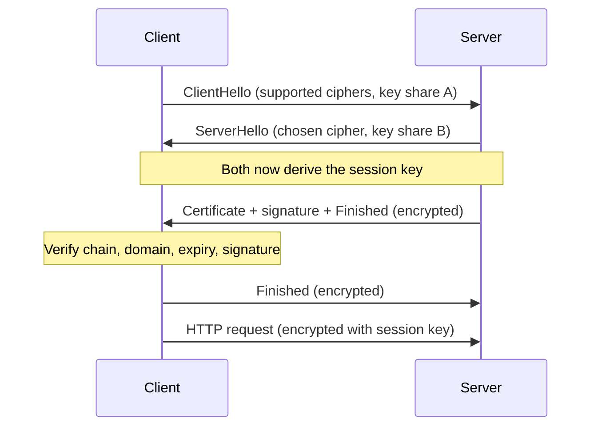

## Definition

**TLS (Transport Layer Security)** is a protocol that creates an encrypted, verified channel between two machines over an untrusted network.

**SSL (Secure Sockets Layer)** is its older, now-insecure predecessor. The name survives in phrases like "SSL certificate", but every modern connection uses TLS.

## The problem it solves

Data on the internet passes through many machines owned by other people: Wi-Fi routers, ISPs, backbone providers. Without protection, any of them can read it, change it, or pretend to be the destination.

| Threat | Example | TLS guarantee |
|---|---|---|
| Reading traffic | A café Wi-Fi captures a password | **Confidentiality** — data is encrypted |
| Changing traffic | A network injects ads into a page | **Integrity** — any tampering is detected |
| Impersonation | A fake server poses as `bank.com` | **Authentication** — the server proves its identity |

## How it works

### Where TLS sits

```
HTTP     ← application data
TLS      ← encryption + identity check
TCP      ← reliable delivery
IP       ← addressing and routing
```

**HTTPS** is HTTP sent through a TLS channel. HTTP itself is unchanged; TLS wraps it.

### Two kinds of encryption

| Type | Keys | Speed | Used in TLS for |
|---|---|---|---|
| **Symmetric** | One shared key encrypts and decrypts | Very fast | All application data |
| **Asymmetric** | A public key + a private key | Slow | Agreeing on a key and proving identity |

TLS combines them. Slow asymmetric math runs once at the start; fast symmetric encryption carries everything after.

### Agreeing on a key without sending it: Diffie-Hellman

Both sides compute the same **session key** independently. The key itself never crosses the network.

```
Client                                    Server
secret: a                                 secret: b
public share: A = f(a)  ───── A ─────►
                        ◄──── B ─────     public share: B = f(b)
key = combine(a, B)                       key = combine(b, A)
          └──────────── same key ────────────┘
```

- An observer sees `A` and `B` but cannot reverse them into `a` or `b`.
- TLS 1.3 uses **ECDHE**: elliptic-curve Diffie-Hellman, **ephemeral**. Fresh secrets are generated for every connection.

```js
// Node built-in crypto: both sides derive the same key
const crypto = require('crypto');

const client = crypto.createECDH('prime256v1');
const clientShare = client.generateKeys();   // sent over the network

const server = crypto.createECDH('prime256v1');
const serverShare = server.generateKeys();   // sent over the network

const clientKey = client.computeSecret(serverShare);
const serverKey = server.computeSecret(clientShare);

console.log(clientKey.equals(serverKey));    // true — never transmitted
```

### Proving who is on the other end: certificates

Diffie-Hellman alone cannot tell *who* the other side is. An attacker in the middle could run the exchange separately with each side and read everything — a **man-in-the-middle (MITM)** attack.

A **certificate** is the server's signed identity card:

| Field | Contains |
|---|---|
| Subject | The domain, e.g. `example.com` |
| Public key | The server's public key |
| Validity | Start and expiry dates |
| Issuer | The authority that vouched for it |
| Signature | The issuer's digital signature over all of the above |

A **digital signature** is made with a private key and checked with the matching public key. Only the private-key holder can sign; anyone can verify.

### Chain of trust

```
Root CA           ← pre-installed in the OS/browser trust store
   │ signs
Intermediate CA   ← does day-to-day signing; root stays offline
   │ signs
example.com       ← "leaf" certificate sent by the server
```

The client walks up the chain until it reaches a root it already trusts.

### Why a stolen certificate is useless

1. The server sends its certificate (public — anyone can copy it).
2. The server **signs its Diffie-Hellman share** with its private key.
3. The client verifies that signature with the public key inside the certificate.

An attacker can copy the certificate but not the private key, so step 3 fails.

### The TLS 1.3 handshake



- **TLS 1.3:** one round trip before data flows.
- **TLS 1.2:** two round trips.
- Resumed sessions can send data immediately (**0-RTT**), at the cost of replay risk.

### What the client checks

| Check | Fails when |
|---|---|
| Chain ends at a trusted root | Self-signed or unknown issuer |
| Domain matches the URL | Certificate is for a different host |
| Within validity dates | Certificate has expired |
| Not revoked | The issuer has withdrawn it |
| Signature on key share is valid | Someone is impersonating the server |

Any failure stops the connection and the browser shows a security warning.

## Key terms

| Term | Plain-English meaning |
|---|---|
| Session key | Temporary symmetric key used to encrypt one connection |
| Public / private key | A matched pair; public is shared freely, private never leaves its owner |
| Diffie-Hellman (ECDHE) | Method for two parties to compute a shared key without sending it |
| Certificate | Signed document binding a domain name to a public key |
| Certificate Authority (CA) | Organisation that verifies domain ownership and signs certificates |
| Trust store | List of root CAs an OS or browser trusts by default |
| Forward secrecy | Stealing a server's private key later cannot decrypt past recorded traffic |
| TLS termination | The point where TLS is decrypted, often a load balancer or CDN |
| SNI | Field in ClientHello naming the requested domain, so one IP can host many certificates |

## Trade-offs

| Choice | Buys you | Costs you |
|---|---|---|
| TLS on every connection | Privacy, integrity, identity | Extra round trip and CPU on connect |
| TLS 1.3 over 1.2 | Faster handshake, forward secrecy always on | Very old clients cannot connect |
| 0-RTT resumption | Zero added latency on reconnect | Early data can be replayed by an attacker |
| Terminate TLS at the load balancer | Offloads crypto, lets the balancer read HTTP for routing | Traffic behind it is plain unless re-encrypted |
| End-to-end TLS (re-encrypt to backends) | Encrypted on internal networks too | More certificates to manage, more CPU |
| Short-lived certificates | Smaller damage window if a key leaks | Renewal must be fully automated |
| Mutual TLS (mTLS) | Client also proves identity — common between services | Every client needs and rotates a certificate |

## In the wild

- **Let's Encrypt** issues free, automated, short-lived certificates, which made HTTPS the default across the web.
- **Cloudflare** and other CDNs terminate TLS at edge servers close to users, cutting handshake latency.
- **AWS Certificate Manager** issues certificates for load balancers and CloudFront and never exposes the private key to the customer.
- **Chrome** labels plain-HTTP pages "Not secure", pushing nearly all sites to HTTPS.

## When to use / avoid

**Use**
- Any traffic crossing the public internet — always
- Service-to-service traffic on shared or cloud networks (often as mTLS)
- Anything carrying credentials, tokens or personal data

**Avoid or reconsider**
- 0-RTT for requests that change state (payments, writes) — replay risk
- Hand-managed certificates with no auto-renewal — expiry outages are common
- Inventing custom encryption instead of TLS

## TL;DR

- TLS gives three guarantees: confidentiality, integrity, authentication. HTTPS = HTTP inside TLS.
- Both sides compute a shared **session key** with Diffie-Hellman; the key is never sent.
- Asymmetric crypto sets up the connection; fast symmetric crypto carries the data.
- A **certificate**, signed by a trusted CA, binds a domain to a public key.
- The server signs its key share with its private key, which defeats man-in-the-middle attacks.
- TLS 1.3 needs one round trip and makes forward secrecy mandatory.