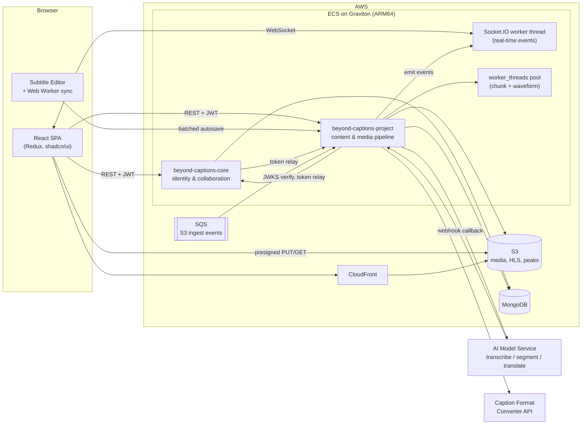
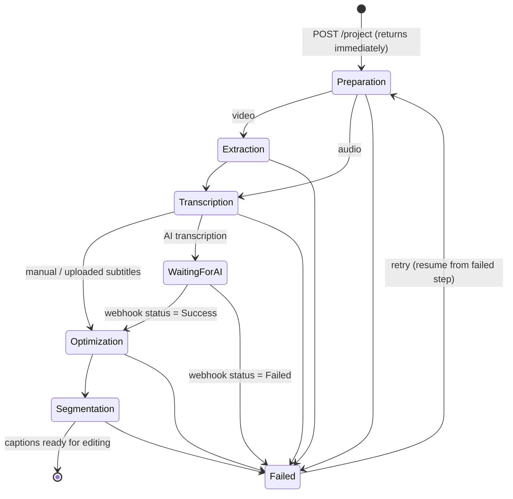
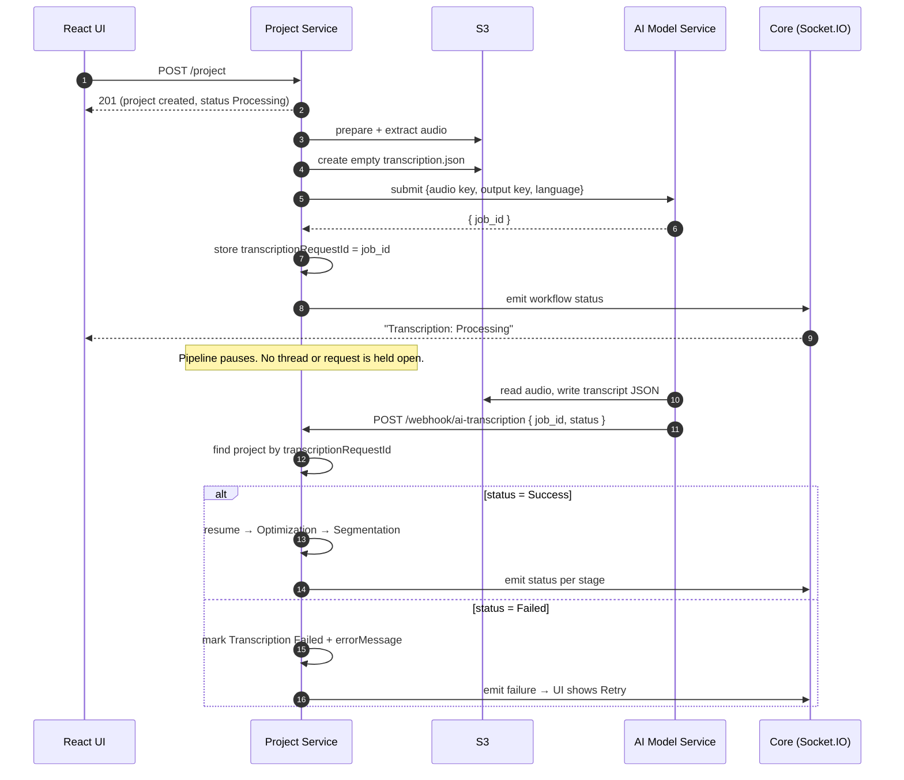
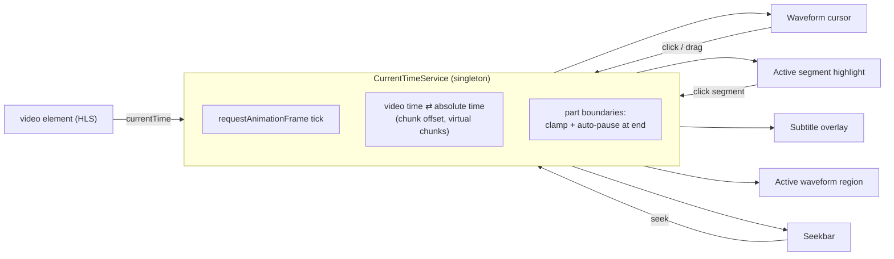
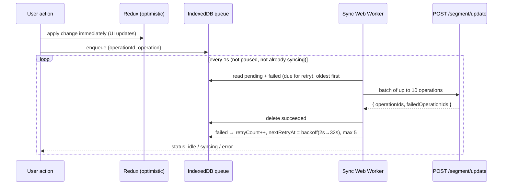
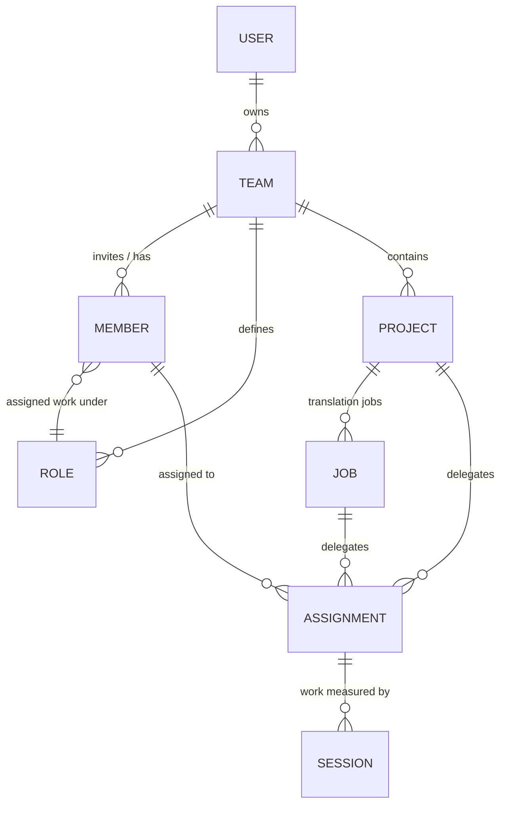

## What it is

**BeyondCaptions** turns video and audio into broadcast-ready subtitles in any language.

A user uploads a video. The platform compresses it, prepares it for streaming, extracts the audio and sends it to an AI model that transcribes the speech, with about **88% first-pass accuracy for Filipino**. The transcript is then split into subtitle segments that follow the team's caption rules: characters per line, number of lines, and minimum and maximum time on screen.

Editors review and correct those subtitles in a **browser-based editor** that shows the video, its audio waveform and the live subtitles side by side. Once the source language is approved, translation jobs produce subtitles in other languages, reviewed in the same editor. Finished subtitles export as `SRT`, `VTT`, `TXT` or `JSON`, as broadcast captions (including `SCC`, through an encoder written in-house), or as a three-column dubbing script.

```
Upload media → AI transcribes → AI segments into subtitles → humans review in the editor
            → approve → AI translates into N languages → humans review translations → export
```

## Why it exists

Before BeyondCaptions, subtitlers typed every line by hand in tools like **Subtitle Edit**, scrubbing the video back and forth to sync each line. It was slow, expensive and hard to coordinate across a team.

| Problem | How BeyondCaptions handles it |
| --- | --- |
| Typing subtitles takes several hours for each hour of video | The AI writes the first draft, so editors correct text instead of typing it. The platform measures the time saved on every project. |
| Caption rules differ by client and channel | **Guidelines** store the rules. AI segmentation follows them, and the editor shows live characters-per-second and character counts. |
| Visual presentation differs by channel | **Styles** store font, size, colour, alignment and position, previewed on the video in real time. |
| A 90-minute video is too much for one person on a deadline | Media is split into ~5-minute **parts**. Several editors work on different parts at once, with locking so two people never edit the same part. |
| Managers can't see who is doing what | **Assignments** delegate work with an expected SLA. Actual time is measured from editor sessions, and each assignment is marked SLA `PASS` or `FAIL`. |
| Measuring AI quality | Every segment keeps its original AI text and timing, so the platform computes an **edit rate**: how much of the AI output humans changed. |
| Departments need their own workspaces | **Teams** with invitations, roles and fine-grained permissions isolate each department's data. |

## Architecture

The platform began as a **Moleculer** microservices monorepo. I re-platformed it into **two focused Express 5 services** that share one typed contract package.



| Decision | Reasoning |
| --- | --- |
| **Two services split by domain**: *core* (who you are, which team you're in) and *project* (the content you work on) | Each scales and deploys independently. The media pipeline is CPU-heavy; identity traffic is light and latency-sensitive. |
| **RS256 JWT + JWKS** | Core signs tokens and publishes its public key at `/.well-known/jwks.json`. The project service verifies tokens **locally** with a cached key set, so no request waits on core just to check a token. |
| **Token relay between services** | Every cross-service call happens inside a user's request, so the caller forwards that user's bearer token. No second token type or shared secret. A 5-second timeout returns a clean `503` if the other service is down. |
| **Presigned S3 URLs** | The browser uploads and downloads media directly. The API never carries media bytes, which keeps the API servers small and fast. |
| **HLS with per-segment presigned URLs** | Presigned URLs can't use wildcards, so the service rewrites the `.m3u8` playlist to give every `.ts` segment its own signed URL, generated in parallel. |
| **Shared `interfaces` package** | One TypeScript contract package is used by the UI and both services, so frontend and backend agree on every request and response at compile time. |

### Two services

**`beyond-captions-core`** owns identity and collaboration: SSO (OneLogin/OIDC) and password login, JWKS publication, teams, invitations and per-member permissions, custom work roles, editor sessions with part locking and active-time tracking, settings, and notifications delivered by a **Socket.IO server running in its own worker thread**.

**`beyond-captions-project`** owns content and media: the project and its **5-stage processing pipeline**, ~5-minute media parts with waveform data, subtitles with batched autosave and multi-format export, translation jobs, a single S3 gateway with automatic ingest from S3 events through SQS, guidelines, styles, watermarks, and assignments with SLA tracking.

Both services expose **auto-generated OpenAPI docs** at `/docs`, built from the same Zod schemas that validate requests, so the docs can't drift from the real behaviour.

## Backend design

### One job per layer

Both services use a strict layered MVC. Every request takes the same path:

```
route → validate(Zod) → controller → service → repository → model (Mongoose)
                                         │
                                         └── throws a typed AppError
                                                    │
                                                    ▼
                                           errorHandler → { success:false, message, data:null }
```

| Layer | Allowed to | Not allowed to |
| --- | --- | --- |
| **Route** | Register the OpenAPI doc and the route, chain middleware | Contain logic |
| **Validate** | Parse `body`, `query` and `params` with Zod and **replace** the raw input with the parsed result | — |
| **Controller** | Unwrap the request, call **one** service method, send the response | Hold business logic or `try/catch` |
| **Service** | Hold all the rules and throw typed errors | Touch `req`/`res` or call Mongoose |
| **Repository** | Run every Mongoose query and own field projections, so sensitive fields can't leak | Be imported by another module |
| **Model** | Define the Mongoose schema, typed against the shared interface | — |

The rules that keep it consistent:

1. **One response shape.** Every success and failure is `{ success, message, data }`.
2. **One error handler.** Services throw and `error.middleware.ts` renders. Express 5 forwards rejected promises, so **no route has a `try/catch`**. Zod errors, duplicate keys, bad ids, expired JWTs, bad JSON and oversized payloads become readable 4xx messages; anything else is a generic 500, and stack traces never reach production clients.
3. **One source of truth per contract.** The same Zod schema drives validation and Swagger.
4. **Only repositories touch Mongoose**, and modules call each other's **services, never repositories**.
5. **No `any`.** Strict TypeScript with `noUncheckedIndexedAccess` and `verbatimModuleSyntax`.

Every module has the same shape, so reading one module teaches you all of them:

```
src/modules/<module>/
├── <module>.model.ts        Mongoose schema
├── <module>.constant.ts     route prefix, OpenAPI tags, projections
├── <module>.repository.ts   all database access
├── <module>.helper.ts       pure functions, no I/O
├── <module>.validation.ts   Zod schemas + contract lock
├── <module>.controller.ts   thin HTTP handlers
├── <module>.routes.ts       OpenAPI registration + router
└── services/
    ├── create.service.ts    one file per group of related use cases
    ├── query.service.ts
    ├── update.service.ts
    └── delete.service.ts
```

Only `services/` is split into several files. Business logic is what grows out of control, so it alone is split by use case.

### The contract lock

Types live in the shared package and runtime validation lives in Zod. A compile-time assertion ties the two together, so if a schema drifts from its contract, **the build fails**:

```ts
export type CreateJobBody = z.infer<typeof CreateJobBodySchema>;
export type _CreateJobBodyMatchesContract = AssertAssignable<CreateJobBody, CreateJobParams>;
// AssertAssignable<T extends U, U> = T  →  if the schema drifts from the contract, the build fails on this line
```

### Dependency injection without a container

Each service is a class that receives its repository as a constructor default and is exported as a singleton. That keeps services testable without a DI framework:

```ts
export class ProjectCreateService {
    constructor(private readonly projects: ProjectRepository = projectRepository) {}
    public async createProject(body: CreateProjectBody, actor: AuthenticatedUser, teamId: string) { … }
}
export const projectCreateService = new ProjectCreateService();
```

Where two modules depend on each other (like `auth` and `teams`), constructor injection would crash at boot with *access before initialization*. Those calls read the other singleton **inside the method body**, which only runs after the whole module graph has loaded.

### Built to run in production

- **Environment validated at boot.** A missing variable stops startup with a readable list, instead of surfacing as `undefined` days later.
- **Structured logging** with `pino`: a request id and logger per request, with credentials redacted.
- **Security middleware:** `helmet`, CORS locked to the UI origin, and per-IP rate limiting. Health checks sit before the limiter, so probes are never throttled.
- **Process guards:** unhandled rejections are logged; uncaught exceptions trigger a graceful shutdown. On `SIGTERM` the HTTP server closes first, then the database, with a force-exit timer as a backstop.
- **Database resilience:** the first connection retries with exponential backoff and jitter. Later drops reconnect without limit while readiness reports unhealthy, so the orchestrator pulls the instance from rotation instead of killing work in progress.

## Hard problem 1: a pipeline that resumes

Creating a project means minutes of CPU-heavy media work plus a long external AI call. An HTTP request can't wait for that, and any step can fail. So the pipeline was designed so that the user gets an **immediate response**, every step is **visible live** in the UI, a failure is recorded against the **exact step** that failed, and **a retry resumes from that step** instead of starting over.



| Stage | What happens |
| --- | --- |
| **1. Preparation** | Download the source from S3, compress it if it's over 100 MB, generate a thumbnail, optionally burn in a watermark with FFmpeg, probe the duration, and generate an **HLS** rendition. |
| **2. Extraction** | Extract the audio track (video projects only). |
| **3. Transcription** | Uploaded or manual subtitles pass straight through. For AI transcription, submit the job and **stop**: the pipeline resumes from a webhook. |
| **4. Optimization** | Split the media into ~5-minute parts that overlap by 10 seconds, each with a thumbnail, audio clip and waveform peaks, built in **parallel worker threads**. |
| **5. Segmentation** | Create subtitle segments from the AI transcript (re-flowed to follow the guideline) or from an uploaded subtitle file in any format. |

Every stage is a plain async function built on the same template:

```ts
export async function runOptimizationPipeline(project, actor, teamId, retryPipeline?) {
    const startedAt = Date.now();
    try {
        await projectWorkflowService.updateAndNotify(id, teamId, { currentStep: "Optimization", currentStepStatus: "Processing" });
        // … do the work …
        const updated = await projectWorkflowService.updateAndNotify(id, teamId, {
            currentStep: "Optimization", currentStepStatus: "Success",
            optimizationTimeTaken: Date.now() - startedAt, isOptimizationCompleted: true,
        });
        void runSegmentationPipeline(updated, actor, teamId).catch(logError);   // fire-and-forget hand-off
    } catch (error) {
        await projectWorkflowService.updateAndNotify(id, teamId, {
            currentStep: "Optimization", currentStepStatus: "Failed", errorMessage: error.message,
        });
    } finally {
        await fs.promises.rm(tempFolder, { recursive: true, force: true });       // always clean up the disk
    }
}
```

- **Every state change is saved *and* broadcast.** `updateAndNotify()` writes to MongoDB, then emits events for the project page and the team's project list, so each card shows its progress live without polling.
- **Fire-and-forget hand-offs.** One stage never blocks the HTTP response or the previous stage, and a later failure can't crash the process.
- **Guaranteed cleanup.** Each stage works in a per-project temp folder that a `finally` block deletes, so disk usage stays flat even when stages fail.

**Retry resumes only the failed stage**, and each stage is safe to resume. Optimization re-downloads its input from S3 if the retry lands on a different container. Chunk creation is all-or-nothing (`deleteMany` then `insertMany`), so a retry never leaves duplicate parts. Completed stages never repeat, so a failure at segmentation doesn't re-encode the video.

That's the main reason **fewer projects fail for good**: an S3 hiccup, an AI timeout or a container restart becomes one click on *Retry* instead of a new upload.

## Hard problem 2: an async AI service

Transcription is the one truly asynchronous leg. It can take longer than the media itself and runs on a separate AI service, so the project service hands the work off and **waits for a webhook**.



- **Shared storage instead of payloads.** The AI service gets the S3 location of the audio and an *empty output file created in advance*. Large audio and transcripts never travel over HTTP.
- **Correlation id.** The returned `job_id` is stored as `transcriptionRequestId`, which the webhook uses to find the project.
- **Idempotent webhook.** If the project is already transcribed, the callback is rejected, so a duplicate or late delivery can never start the pipeline twice.
- **No user session needed.** The callback is machine-to-machine, so the handler builds an internal actor from the project's stored owner to resume the pipeline, and status events still reach the user's browser.
- **Pausing costs nothing.** While the AI works, nothing is held open. The project is just a document waiting for its callback, and the service can restart in the meantime.

## Hard problem 3: concurrency and availability

| Concern | Solution |
| --- | --- |
| **Video processing saturated the CPU** (sequential chunking drove ECS tasks to 100%) | Chunks run in **`worker_threads`**, limited by a **semaphore** to `min(3, CPUs − 1)`. One core always stays free for API traffic. Parallel chunking gave roughly **3× throughput**. |
| **A stuck FFmpeg process** | Each worker has a one-hour timeout, results are accepted only once, and workers are always terminated. |
| **Large file transfers** | Streaming multipart uploads send FFmpeg output to S3 without buffering whole files in memory. Browsers upload straight to S3. |
| **Waveforms for long media** | Audio is downsampled on the server to **min/max pairs per pixel**, so the browser fetches a small JSON file instead of raw audio. |
| **Files dropped into S3** | S3 events flow through **SQS** to a long-polling consumer. Messages are acknowledged only after a successful ingest, with exponential backoff on errors. |
| **The other service is down** | Service calls time out after 5 s with a clean `503`, and non-essential calls degrade instead of failing: completing an assignment still succeeds without SLA data. |
| **Two editors on the same part** | Editor sessions lock a part. A project-wide *Shift Segments* session is **refused while anyone else is editing**. |
| **The same edit sent twice, or one bad edit in a batch** | Inserts treat a duplicate key as "already applied", and each operation in a batch succeeds or fails on its own, so the client retries only the failures. |

## Frontend

The UI is **React 19 + TypeScript** built with Vite, with **Redux Toolkit** (one slice per feature, every API call in a `createAsyncThunk`), **Tailwind CSS v4 + shadcn/ui** for an accessible design system with **light and dark themes**, and **React Router 7**.

There's **one Axios instance per backend**, built from the same factory. Interceptors add the bearer token and `team-id` header to every call, and turn a `401` into a global *session expired* modal instead of a silent failure. Request and response types come from the **same shared package as the backend**, so a backend contract change breaks the frontend build, not production.

Reusable pieces keep the app consistent:

- **`CommonTable`**: a generic TanStack table. Every list (projects, files, guidelines, styles, members, roles) is the same component with a different column file, and search, pagination, selection and resizing are opt-in flags.
- **Shared field components** per entity, so create and update dialogs define validation and layout once.
- **`PermissionCheckBox`**, built from permission metadata in the shared contract. Adding a permission to the contract adds it to the UI automatically.
- **`UploadTracker`**: a global upload tray, so users keep working while large media uploads.
- **Custom hooks** keep behaviour out of components: `useSocket`, `useEditorSession`, `useUndoRedo`, `useSingleTab` and more.

Small details that matter: pipeline progress updates **live over WebSocket**; `useSingleTab` uses the **Web Locks API** to stop a second tab fighting over the same editor session; `navigator.sendBeacon` ends the session reliably when a tab closes; and the waveform canvas reads its colour from CSS variables, so it follows the theme.

## Hard problem 4: the subtitle editor

The editor is a full-viewport application inside the SPA where **video, waveform, timeline, subtitle overlay and a rich-text segment list stay in sync to the millisecond**, while edits save continuously and several people work on the same project. It has a **subtitle mode** (cards with timing, duration, character count and CPS), a **generic mode** for reading flow, and a **translation mode** that shows the matching source text under each translated line.

### One clock for everything

Six things must agree on "now": the video, the waveform cursor, the active segment, the subtitle overlay, the active waveform region and the seek bar. If each listened to `timeupdate` on its own, they would drift apart and re-render React far too often.



- **A single `requestAnimationFrame` loop** reads `currentTime` once per frame and pushes it to subscribers, which update their own DOM, so the store isn't rewritten 60 times a second.
- **Absolute time everywhere.** Segments use project time; conversion to video time happens **only** here. That makes **virtual chunks** possible: when edits push subtitles past the end of the media, metadata-only parts extend the timeline.
- **Part boundaries.** The service clamps seeking to the loaded part and pauses exactly at its end.
- **Two-way.** Clicking the waveform, seek bar or a segment sets the time once, and everyone updates, even while paused.

### Rich text without a jumping cursor

Each segment body is a `contenteditable` with bold, italic, underline and colour. React and `contenteditable` don't mix well: if React re-renders the content, the caret jumps to the start. So the editor follows a strict pattern:

1. **Set the content once** when the card mounts.
2. **Let the browser own the DOM**: typing, caret, IME input and selection stay native.
3. **A `MutationObserver` detects changes** and debounces a save after a short pause.
4. **Redux stays the source of truth**: the save converts the DOM back to `styledText` and plain `text`.
5. **Toolbar formatting** saves the selection as character offsets, rewrites the HTML, then restores the caret with a `Range`.

Spell checking runs **offline** with `nspell` and Hunspell dictionaries, with suggestions in a right-click menu.

### Waveform, timeline and preview

Waveform peaks are **precomputed on the server** and drawn on a canvas whose width is `duration × zoom`. Segment regions sit on top, **memoized per region**, so dragging one re-renders only that one. A drag updates locally and commits **once** on release, as a single operation that stores both the new and original timing for undo, and neighbouring segments stop regions from overlapping.

Video plays over **HLS** (`hls.js`, native in Safari) with error recovery. Subtitles are an **overlay**, not burned in, rendered with the project's **Style**, so editors see exactly what viewers will see as they type.

### Offline-first autosave

Edits aren't sent once per keystroke. Each action becomes an **operation** (`addSegment`, `deleteSegment`, `mergeSegment`, `splitSegment`, `updateSegmentFields`, `updateSegmentTimestamp`, `rippleSegmentsOffset`) that's applied to Redux immediately and queued for the server.



- **Durable:** operations live in **IndexedDB**, so a reload or a short outage loses nothing.
- **Off the main thread:** a dedicated **Web Worker** runs the sync loop, so typing and playback never stutter.
- **Idempotent and partial-failure safe:** every operation has a UUID, and the worker retries only the operations the server reports as failed, with exponential backoff.
- **Undo is a real edit:** undo and redo apply the inverse to Redux *and* queue the inverse operation, so they persist like any other change.

### Editing tools and collaboration

Editors can **split** at the caret (keeping inline formatting intact), **merge** segments, and use **ripple tools** that retime one subtitle and shift every later one in a single server-side update. There's **find and replace**, bookmarks, validation status, and **live CPS and character counts** checked against the guideline.

Opening a part **acquires a session** in core. Other users see a *Part Locked* modal listing the free parts, and real-time lock events update everyone's parts strip. A **heartbeat every 60 seconds** adds to the measured active time that feeds SLA reports.

## Teams, roles and assignments



- **Teams** are workspaces. The active team travels on every request as a `team-id` header, and middleware **scopes every query** to it.
- **Members** are invitations that expire after 24 hours. Accepting requires the signed-in email to **match the invited email**, so nobody else can accept an invite.
- **Access roles** (`Admin`, `Co-admin`, `Collaborator`) come with a **permission map** customizable per member, from `canEditCaption` to `canManageMembers`. Defaults live in the shared contract, so API checks and UI checkboxes always match.
- **Work roles** like "Transcriber", "QC" or "Translator" describe *what kind of work* an assignment is.

A manager assigns the source project or a translation job to a member, with an **expected SLA**. When the member clicks **Done**, the service collects that assignment's editor sessions and computes the real working time from **measured active seconds, not wall-clock time**. The assignment is marked `PASS` if that's within the SLA, otherwise `FAIL`.

That data feeds **writer, member-performance, editor-productivity and project-status reports**, plus a **QC edit-rate report** that compares final subtitles with the stored AI originals to show how much correction the AI needed and how much time it saved.

## Data model

The key decision: **a project *is* the source job.** Projects aren't copied into the `jobs` collection. Instead, `jobId` on segments and assignments is a **nullable discriminator**: `null` means source, a value means a translation. One query shape, `{ projectId, jobId }`, serves both editors, so the source and translation editors share 100% of their code.

```
projects (1) ←── jobs (many)
    │                 │
    ├──→ segments ←───┘        jobId: null  → source segment
    │                 │        jobId: <id>  → translation segment
    └──→ assignments ←┘        same discriminator for assignments
```

- **Public UUIDs, hidden `_id`.** Every entity has its own **UUID v6** (time-ordered, so it sorts by creation time), and repositories hide Mongo's `_id`.
- **Tenant key on every document.** `teamId` is copied onto every content document, so tenant isolation is one filter, with no joins.
- **The pipeline state lives on the project document**, so state survives restarts.
- **`original*` fields** on segments keep the AI's first text and timing, which powers the edit-rate report and source-to-translation matching.
- **Precomputed metrics.** QC metrics are computed once and stored, so reports don't diff thousands of segments on every view.
- **Schema changes never break data.** New fields always ship with defaults, and backfills run as a separate migration project.

## Infrastructure and delivery

- **Containers:** multi-stage Docker builds for **ARM64 / AWS Graviton**. The runtime image ships only compiled output and production dependencies, plus FFmpeg for the project service.
- **CI/CD:** CodeBuild → ECR (images tagged with the commit hash) → **CodePipeline** → ECS deploy.
- **Runtime:** ECS services (4 vCPU / 8 GB for media processing), MongoDB, S3 for all media, SQS for ingest events, and a Socket.IO port for real-time updates.
- **Frontend:** a Vite production build served through **CloudFront**.

## Highlights

**Backend**
- Re-platformed a Moleculer monorepo into two Express 5 services with **strict layered MVC**, one error pipeline, and **Zod schemas that drive validation, OpenAPI docs and compile-time contract checks**.
- A **resumable, event-driven 5-stage media pipeline** with live progress and retry from the failed step.
- **Async AI integration through webhooks**, with shared-storage hand-off, a correlation id and an idempotent callback.
- **CPU-aware parallel processing** with worker threads and a semaphore: about **3× throughput** with the API still responsive.
- **RS256/JWKS auth** verified locally, and service-to-service **token relay** with timeouts and graceful fallbacks.

**Frontend**
- A professional **browser subtitle editor**: HLS video, canvas waveform with draggable regions, live styled overlay and a rich-text segment list, all driven by **one `requestAnimationFrame` clock**.
- **Offline-first autosave** with an IndexedDB queue, a sync **Web Worker**, idempotent operations and persisted **undo/redo**.
- **Real-time collaboration**: part locking, heartbeats, beacon on tab close and a single-tab guard with the Web Locks API.

**Data**
- A MongoDB model where **the project is the source job**, segments know their parts, AI originals enable QC analytics, and every document carries its tenant key.
