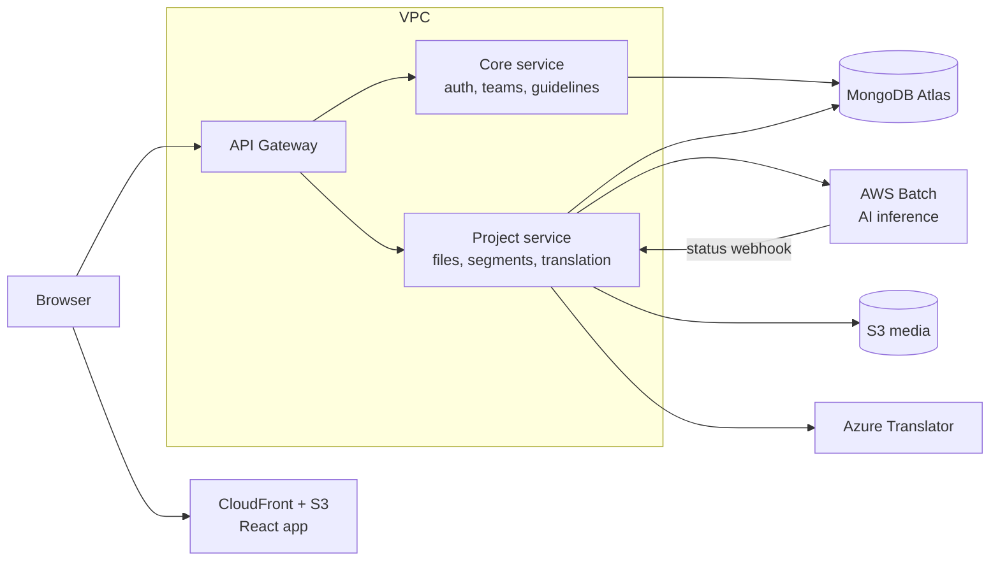

## The problem

Subtitling at ABS-CBN was done entirely by hand. Subtitlers opened a video in **Subtitle Edit** or a similar open-source tool, watched a few seconds, paused, typed what they heard, and then nudged the timing until the text lined up with the speech. Every line, every video.

The typing was slow, but the syncing was worse. Matching a subtitle to the exact moment someone starts speaking meant scrubbing back and forth over the same few frames, again and again.

## What I built

**BeyondCaptions** turns that work around: the machine writes the first draft, and people review it.

A user picks a video from storage, adds its metadata, and creates a project. The video goes straight to an **in-house AI model** that returns a transcript already shaped like subtitles: split into segments, each with a start and end time. For Filipino it gets about **88% right on the first pass**, so the subtitler's job changes from typing everything to fixing what the model missed.

From there the project can be translated into multiple languages with **Azure Translator** and exported as `SRT`, `VTT`, `SCC` or `STL`.

## The editor

The editor is where subtitlers spend their day, so it got the most care. It runs in the browser and keeps four views locked together: the **video**, the **audio waveform**, the **timeline** and the **segment list**. Move through any one of them and the others follow.

Editing goes beyond a text box. Subtitlers can **split** a long segment at the cursor, **merge** short ones, apply **styles**, and run **find and replace** across a whole project. Splitting is a good example of how small these operations stay once the data model is right:

```ts
type Segment = {
  id: string;
  start: number; // seconds
  end: number;
  text: string;
};

function splitSegment(segment: Segment, at: number, cursor: number): [Segment, Segment] {
  return [
    { ...segment, end: at, text: segment.text.slice(0, cursor).trim() },
    { ...segment, id: crypto.randomUUID(), start: at, text: segment.text.slice(cursor).trim() },
  ];
}
```

Teams can also set **subtitle guidelines**, house **styles**, and **watermarks**, so every project leaves the editor looking the same.

## Teams and projects

BeyondCaptions is used by teams, not just individuals, so it includes its own project management. Users create teams, assign members to projects, and follow each person's output through **KPI reports**.

## Under the hood

The platform is two **Node.js** microservices on **AWS ECS**, inside a private **VPC**, with every request entering through **API Gateway**.

- **Core** handles authentication, teams, guidelines and styles.
- **Project** handles files, projects, segments and translations.

The frontend is a **React + TypeScript + Tailwind** single-page app, served from **S3** through **CloudFront**.



### Running the AI model

Transcription takes minutes, not milliseconds, so it can't run inside a normal API request. Each video becomes an **AWS Batch** job that moves through `INITIATED`, `QUEUED`, and then `COMPLETED` or `FAILED`. Instead of the Project service checking on it repeatedly, Batch reports every status change back through a **webhook**. A simplified version of that handler:

```js
router.post("/webhooks/ai-jobs", async (req, res) => {
  const { jobId, status } = req.body;

  const job = await AiJob.findOneAndUpdate({ jobId }, { status }, { new: true });
  if (!job) return res.sendStatus(404);

  if (status === "COMPLETED") await importSegments(job);
  if (status === "FAILED") await markProjectFailed(job.projectId);

  res.sendStatus(200);
});
```

The editor shows the same status to the user, so a subtitler always knows whether their draft is still queued, being transcribed, or ready to review.

### Security and delivery

Media in **S3** is reachable only by the ECS services, through their **IAM role**, so it can't be accessed from outside the platform. Credentials live in **AWS Secrets Manager**, and data is stored in **MongoDB Atlas**.

Both the UI and the API ship through **AWS CodePipeline**, so every release follows the same automated path.
