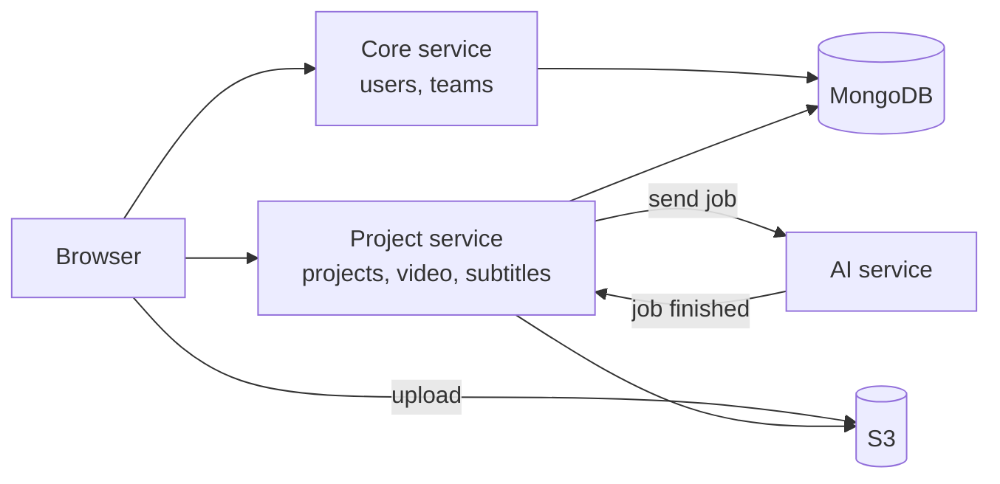

## The problem

Subtitlers typed every line by hand in tools like **Subtitle Edit**, moving the video back and forth to match the timing. One hour of video took several hours of work.

## What I built

**BeyondCaptions** lets AI write the first draft, so people only need to review it.

1. **Upload** a video.
2. **AI writes the subtitles**: about **88% accurate for Filipino** on the first try.
3. **Editors review** them in a browser editor with the video, waveform and subtitles side by side.
4. **AI translates** them into other languages.
5. **Download** as `SRT`, `VTT`, `SCC` and more.

Teams can also set **subtitle rules and styles**, split long videos so **several editors work at once**, and **assign work** with target times and reports.

## How it works

Two Node.js services run on **AWS ECS**: one for **users and teams**, one for **projects and video**. The browser uploads files straight to **S3**, and live updates arrive over **WebSockets**.

## Hard problems I solved

### A pipeline that can resume

Processing a video takes minutes and any step can fail. Each project moves through **5 steps** and saves its progress after every one. The user sees each step live, and **Retry continues from the failed step** instead of starting over.

### Waiting for the AI

The AI can take longer than the video itself. Instead of waiting, the service sends the job and moves on, and the AI **calls back** when it's done. Nothing is held open, and a repeated callback is safely ignored.

### Fast without slowing down

Video work used to take 100% of the CPU. Now video parts are processed **in parallel**, always leaving one core free for users. Processing became **about 3× faster**.

### An editor that never loses work

- **One shared clock** keeps the video, waveform and subtitles in perfect sync.
- **Every change is saved in the browser first** and synced in the background, so a bad connection loses nothing.
- **Parts are locked** while someone edits them, so two people never clash.

## Stack

React, TypeScript, Redux Toolkit, Tailwind CSS, Node.js, Express, MongoDB, AWS ECS, S3, SQS, CloudFront, FFmpeg and Socket.IO.
