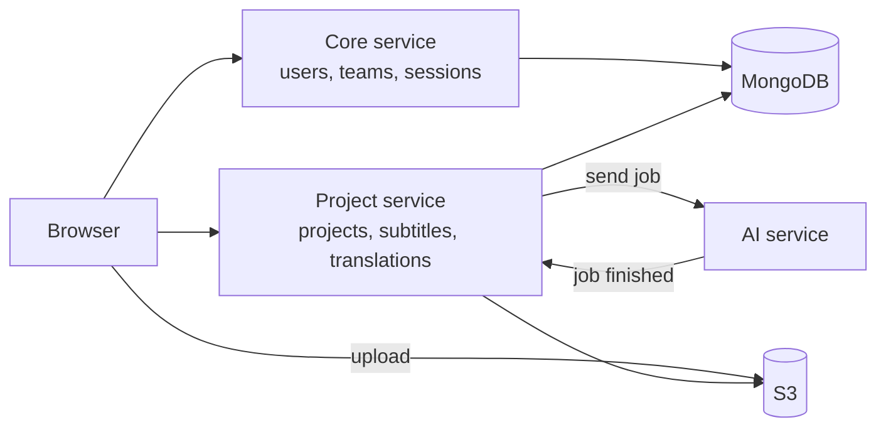
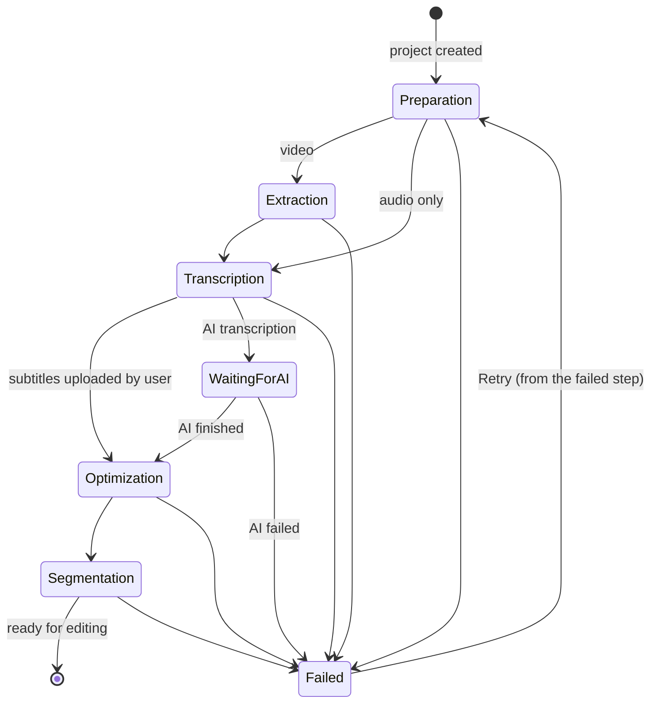
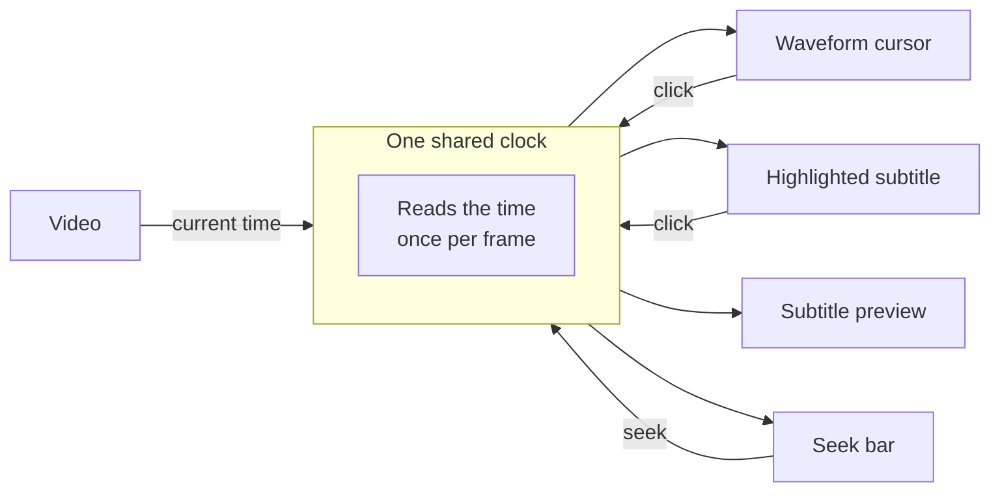
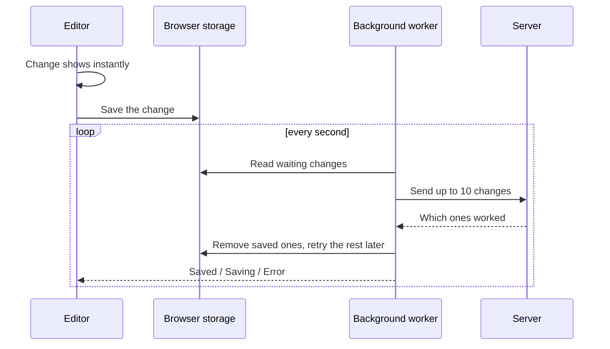
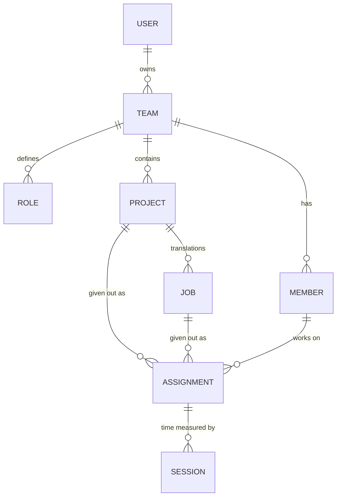

## What it is

**BeyondCaptions** turns video and audio into ready-to-broadcast subtitles in any language.

A user uploads a video. The platform prepares it, pulls out the audio, and sends it to an AI model that writes down what is said. For Filipino, the AI gets about **88% right on the first try**. The text is then split into subtitle lines that follow the team's rules, such as how many characters fit on a line and how long a line stays on screen.

Editors then check and fix the subtitles in a **browser-based editor** that shows the video, the audio waveform and the subtitles together. Once the original language is approved, the AI translates it into other languages, and editors review those too. The final subtitles can be downloaded as `SRT`, `VTT`, `TXT`, `JSON`, broadcast formats like `SCC`, or a dubbing script.

```
Upload → AI writes the text → AI splits it into subtitles → editors review
       → approve → AI translates → editors review translations → download
```

## Why it exists

Before BeyondCaptions, subtitlers typed every line by hand in tools like **Subtitle Edit**, moving the video back and forth to line up the timing. It was slow, costly and hard to manage across a team.

| Problem | How BeyondCaptions solves it |
| --- | --- |
| Typing subtitles takes hours for every hour of video | The AI writes the first draft. Editors only fix it, and the platform tracks the time saved. |
| Every client and channel has different subtitle rules | **Guidelines** store the rules. The AI follows them, and the editor warns when a line breaks one. |
| Every channel wants a different look | **Styles** store the font, size, colour and position, with a live preview on the video. |
| A long video is too much for one person | The video is split into **5-minute parts**, so several editors can work at the same time without clashing. |
| Managers can't see who is doing what | **Assignments** give work to a person with a target time. The platform measures the real time spent and marks it as a pass or fail. |
| Nobody knows how good the AI is | The platform keeps the AI's original text, so it can show **how much editors had to change**. |
| Different departments need their own space | **Teams** with invites, roles and permissions keep each department's work separate. |

## Architecture

The platform runs as **two Node.js microservices** on **AWS ECS**, each made up of several modules, and both share one set of TypeScript types.



| Decision | Why |
| --- | --- |
| **Two services**: *Core* handles people and teams, *Project* handles the content | Each can grow and be released on its own. Video work is heavy; login traffic is light and must stay fast. |
| **Each service checks login tokens itself** | Core signs the tokens and shares its public key. The Project service checks tokens on its own, so it never waits for Core. |
| **The browser uploads files straight to S3** | Large video files never pass through our servers, so the servers stay small and fast. |
| **Video streams in small pieces (HLS)** | The player loads the video bit by bit, straight from S3, instead of downloading the whole file first. |
| **Live updates over WebSockets** | Progress, locks and notifications reach the browser instantly, without the page asking again and again. |
| **One shared set of types** | The frontend and both services use the same TypeScript types, so a mismatch is caught when the code is built, not by users. |

**The Core service** handles **users, teams and sessions**.

**The Project service** handles **projects, subtitles and translations**.

Both services publish **API documentation that is generated from the code**, so the docs are always up to date.

## Backend design

### Every request follows the same path

Each request goes through the same layers, and each layer has one job:

| Layer | Its job |
| --- | --- |
| **Route** | Connects a URL to the right code. No logic. |
| **Validation** | Checks the incoming data with Zod and rejects anything wrong. |
| **Controller** | Reads the request, calls one service, sends back the answer. |
| **Service** | Holds the business rules. |
| **Repository** | Talks to the database. Nothing else does. |
| **Model** | Describes the shape of the data in MongoDB. |

Every module uses the same folder layout, so once you know one module, you know them all. If the validation rules and the shared types ever stop matching, **the build fails** before the change can go live.

### Built for production

- **Settings are checked at startup.** A missing setting stops the app with a clear message, instead of causing a strange bug days later.
- **Every request is logged with an id**, and passwords and tokens are hidden from the logs.
- **Security basics are built in:** safe HTTP headers, requests allowed only from our own UI, and limits on how many requests one visitor can make.
- **The app shuts down cleanly**, finishing current work before it stops.
- **Database drops are handled.** The app keeps reconnecting and tells AWS it's not ready, so no user requests reach it until it recovers.

## Hard problem 1: a pipeline that can resume

Creating a project means minutes of heavy video work plus an AI step that can take a long time. A web request can't wait that long, and any step can fail.

So I designed it so that:

- the user gets an **answer straight away**,
- they can **watch every step live**,
- a failure shows **exactly which step** broke,
- and **Retry continues from that step** instead of starting over.



| Step | What happens |
| --- | --- |
| **1. Preparation** | Shrink large videos, make a thumbnail, add a watermark if needed, and prepare the video for streaming. |
| **2. Extraction** | Pull the audio out of the video. |
| **3. Transcription** | Send the audio to the AI, then **pause** until the AI is done. Uploaded subtitles skip this step. |
| **4. Optimization** | Cut the media into 5-minute parts, each with its own thumbnail, audio and waveform, several at a time. |
| **5. Segmentation** | Turn the text into subtitle lines that follow the team's rules. |

Each step works the same way. It marks itself as *running*, does its work, saves the result, and starts the next step. If something goes wrong, it saves the error against that step.

- **Every change is saved and sent live** to the browser, so the project card updates on its own.
- **Steps never wait on each other**, so one slow step never blocks the user.
- **Temporary files are always deleted**, even when a step fails, so the disk never fills up.

Retry only runs the step that failed. Finished steps are never repeated, so a failure at the end doesn't mean processing the whole video again. That's why **fewer projects fail for good**: a network blip or a server restart becomes one click on *Retry* instead of a new upload.

## Hard problem 2: heavy work without slowing down

| Problem | Solution |
| --- | --- |
| **Video work used 100% of the CPU** and slowed everything down | Parts are processed in parallel on background threads, but always leaving one CPU core free for users. This made processing about **3× faster**. |
| **A video job could get stuck** | Each job has a time limit and is always cleaned up. |
| **Large files used too much memory** | Files are streamed to S3 piece by piece, never loaded fully into memory. |
| **Waveforms for long videos were heavy** | The server turns the audio into a small summary file, so the browser downloads a few kilobytes instead of the full audio. |
| **Files dropped straight into S3** | S3 sends an event to a queue (SQS). The app picks it up and adds the file, and failed ones are tried again later. |
| **The other service is down** | Calls give up after 5 seconds with a clear error, and less important features keep working without it. |
| **Two editors on the same part** | Opening a part locks it, so nobody else can edit it at the same time. |
| **The same edit sent twice** | Each edit has a unique id, so a repeat is simply ignored. |

## Frontend

The UI is built with **React 19, TypeScript, Redux Toolkit, Tailwind CSS and shadcn/ui**, with **light and dark themes**.

All API calls go through one shared setup that adds the login token and team to every request. If a login expires, the user sees a clear "session expired" message instead of a silent failure. The frontend uses **the same types as the backend**, so if the API changes, the frontend build catches it.

Reusable parts keep the whole app consistent:

- **One table component** powers every list in the app: projects, files, members and more.
- **Shared form fields**, so each create and edit form is defined once.
- **Permission checkboxes built from the shared types.** A new permission appears in the UI automatically.
- **An upload tray**, so users can keep working while big files upload.

Small details that matter: progress updates appear **live**; opening a second tab is blocked so two tabs can't fight over one session; and the session is closed properly even when the tab is closed.

## Hard problem 3: the subtitle editor

The editor is where subtitlers spend their day. It shows the **video, waveform, timeline, subtitle preview and the list of subtitles**, all kept in perfect sync, while saving every change and letting several people work on one project.

### One clock for everything

Six parts of the screen need to agree on the current time: the video, the waveform cursor, the highlighted subtitle, the subtitle preview, the waveform region and the seek bar. If each tracked time on its own, they would drift apart and slow the page down.



One shared clock reads the video's time once per frame and tells everyone else. Click anywhere (the waveform, the seek bar or a subtitle) and every part jumps to the same moment, even while the video is paused.

### Typing without a jumping cursor

Each subtitle supports **bold, italic, underline and colour**. A common problem with editable text in React is that the cursor jumps to the start while you type. To avoid that, the browser handles the typing, and the app only saves the text after a short pause. When formatting is applied, the app remembers where the cursor was and puts it back.

Spell check works **offline**, with suggestions on right-click.

### Waveform and preview

The waveform is drawn from the small summary file made by the server. Each subtitle appears as a block on the waveform that can be **dragged and resized**. Only the block being moved redraws, and subtitles can never overlap.

The video streams with **HLS**, and the subtitles are shown on top using the project's style, so editors see exactly what viewers will see.

### Autosave that survives bad internet

Changes aren't sent on every keystroke. Each change (add, delete, split, merge, retime) is saved **in the browser first** and sent to the server in small batches in the background.



- **Nothing is lost.** Changes are stored in the browser, so a refresh or a dropped connection loses nothing.
- **Typing never lags.** Syncing runs in a background worker, away from the screen.
- **Only failures are retried**, with longer waits between each try.
- **Undo and redo are saved too**, just like normal changes.

### Editing tools and teamwork

Editors can **split and merge** subtitles, **shift the timing** of all later subtitles in one go, use **find and replace**, add bookmarks, and see **live warnings** when a line is too long or too fast to read.

When someone opens a part, it's **locked** for them, and others see who has it. While they work, the editor records their **active time**, which feeds the reports.

## Teams, roles and assignments



- **Teams** are separate workspaces. Every request only sees the data of the current team.
- **Invites** expire after 24 hours, and only the invited email address can accept them.
- **Access roles** (Admin, Co-admin, Collaborator) come with permissions that can be adjusted per person.
- **Work roles** like "Transcriber", "QC" or "Translator" describe the kind of work.

A manager gives a project or translation to a team member with a **target time**. When the member clicks **Done**, the platform adds up their **real active editing time**, not just the time the page was open, and marks the work as a **pass** or **fail**.

This data feeds reports on **team performance, productivity and project status**, plus a **quality report** that shows how much of the AI's work editors had to change.

## Data model

The key idea: **a project is also its own source-language job.** Translations are separate jobs. Every subtitle has a `jobId`: empty means the original language, a value means a translation. Because of this, **the same editor code works for both** originals and translations.

- **Every record has its own public id**, and database internals are never shown to users.
- **Every record carries its team id**, so keeping teams apart is one simple filter.
- **Each project saves its own progress**, so nothing is lost if a server restarts.
- **The AI's original text is kept**, which powers the quality report.
- **Reports are calculated once and stored**, so they load fast.
- **New fields always have defaults**, so old data keeps working with no downtime.

## Infrastructure

- **Docker images** built for **AWS Graviton** (ARM) servers, containing only what's needed to run.
- **Automatic deployment:** every change is built and released through **AWS CodeBuild and CodePipeline** to **ECS**.
- **AWS services:** ECS for the servers, S3 for media, SQS for file events, CloudFront for the website, and MongoDB for data.

## Highlights

- **Two Node.js microservices** with clear modules, one shared set of types and docs generated from the code.
- A **5-step video pipeline** that shows live progress and **resumes from the failed step**.
- **About 3× faster video processing**, while keeping the app responsive.
- A **professional subtitle editor in the browser**, with video, waveform and subtitles kept in sync by one shared clock.
- **Autosave that survives bad internet**, with undo and redo.
- **Real-time teamwork**: part locking, live updates and measured working time.

## Stack

React, TypeScript, Redux Toolkit, Tailwind CSS, shadcn/ui, Node.js, Express, Zod, MongoDB, AWS ECS, S3, SQS, CloudFront, CodePipeline, FFmpeg, HLS and Socket.IO.
