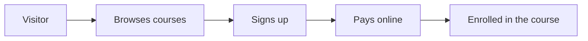

## What it was

**MetaDemy** was a small ed-tech startup I co-founded under **Metaverse Internet Pvt. Ltd.** in Bhubaneswar.

We saw that many students and working professionals wanted to learn **competitive coding** and **full-stack development**, but good courses were either too expensive or not available locally. MetaDemy offered practical courses at an **affordable price**, taught by people who wrote code every day.

## What I did

Being a small team, I worked on both the **technology** and the **business**.

### The platform

I built the MetaDemy platform with **PHP Laravel** and **MySQL**:

- **Course pages** describing each course, its topics and its price.
- **Student sign-up**, so learners could create an account and enroll.
- **Online payments**, through an integrated **payment gateway**.
- **Redis** caching to keep pages fast.
- **Hosting on AWS**.

### The business

Outside of the code, I helped with **sales**: talking to students, explaining the courses and enrolling them. I also helped with **teaching** and supporting students during the course. Balancing building, selling and teaching taught me a lot about what a product really needs to succeed.

## Result

- **23 students** joined the first batch.
- The first batch earned **₹2.7 lakh** in revenue.
- **90%** of students completed their course.

It was a small start, but it showed that people wanted affordable, practical coding courses.

## What I learned

Running MetaDemy taught me that building software is only one part of a product. Understanding users, pricing, sales and support matter just as much. These lessons shaped how I think about products to this day.

## Stack

PHP Laravel, MySQL, Redis and AWS.
