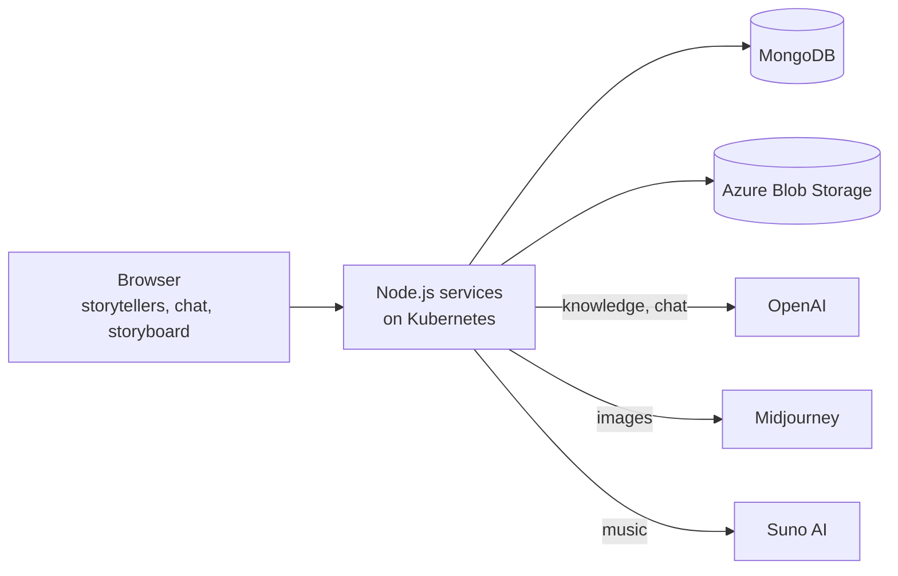
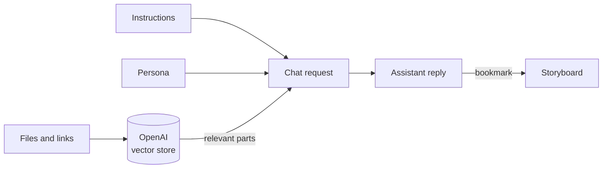

## What it is

**StorytellerAI** is a creative AI companion. It works like the OpenAI Playground, but built around **your own AI assistants**, called **storytellers**, that help creators with ideas, scripts, images and music. It's made for **podcasters, scriptwriters, makeup artists, marketers** and any creative professional who wants to work faster while keeping their own voice.

You can create **as many storytellers as you need**, each with its own:

- **Name and persona:** who the storyteller is, for example *"Jacob, a writer who loves making up mystery stories"*.
- **Genre and style:** fantasy and concise, mystery and descriptive, horror and emotional, and so on.
- **Instructions:** how it should behave and respond.
- **Knowledge base:** documents, PDFs, videos, voice notes, images and public links it should learn from.


Then you **chat** with your storyteller, and it answers using everything you gave it. Every reply can be **bookmarked, copied, regenerated** or **turned into images**. You can also **generate music**, and collect the best pieces on a **storyboard**: an infinite canvas where the story comes together.

```
Create a storyteller → add persona, instructions and knowledge → chat
                     → generate images and music → bookmark the best parts → build the storyboard
```


## Why it exists

General AI chat tools don't know your world. Every conversation starts from zero, so creative teams kept pasting the same background, tone and references again and again, and the good ideas ended up scattered across long chat histories.

| Problem | How StorytellerAI solves it |
| --- | --- |
| The AI doesn't know your story, brand or world | A **knowledge base** per storyteller, built from your documents, videos, voice notes, images and links. |
| Tone and style change from chat to chat | **Personas, genres and instructions** are saved with each storyteller and applied to every conversation. |
| One assistant can't master every genre | Create **many storytellers**, each with its own persona, purpose and style. |
| Text alone isn't enough for creative work | **Image and music generation** sit right next to the chat. |
| Good ideas get lost in long conversations | **Bookmark** any message and place it on the **storyboard**. |
| Ideas need structure to become a story | The **storyboard** is an infinite canvas where pieces can be arranged and connected. |

## Architecture

StorytellerAI uses **React and TypeScript** on the frontend and **Node.js** services with **MongoDB** on the backend. It runs on **Kubernetes on Azure**, with files stored in **Azure Blob Storage**, and connects to **OpenAI**, **Midjourney** and **Suno AI** for text, images and music.



| Part | What it does |
| --- | --- |
| **React app** | The storyteller settings, the chat and the storyboard canvas. |
| **Node.js services** | Storytellers, knowledge bases, chats, generations and storyboards. |
| **MongoDB** | Stores storytellers, personas, instructions, chats, bookmarks and storyboards. |
| **Azure Blob Storage** | Keeps uploaded files and generated images and music. |
| **OpenAI** | Powers the assistant: the knowledge base search and the chat replies. |
| **Midjourney and Suno AI** | Generate images and music from the story. |

## How the assistant knows your content

The heart of StorytellerAI is giving the AI the right context for every answer.



- **Knowledge base:** when you add files or public links, they are sent to the **OpenAI Assistants API** and stored in a **vector database**. A vector database stores text by meaning, so the assistant can find the parts that matter for each question.
- **Instructions and personas** are turned into **custom prompts** that shape every reply.
- **Chat replies** come from OpenAI's completion API, combining your question, the instructions, the persona and the relevant knowledge.

## Images and music

Text alone isn't enough for creative work, so visuals and sound sit right next to the chat.

**Images** are generated with **Midjourney**. Any reply can be turned into images with one click, and users can create **characters, scenes, costumes and hairstyles**. A **character consistency** feature keeps the same character looking the same across many images, which matters when you're building a story.


**Music** is generated with **Suno AI**. Users describe the song they want, and the AI creates it, **complete with lyrics**. They can also use **their own lyrics**, pick any genre or style, or create **instrumental tracks**, like a background score for a trailer.


Generated images and music are saved to **Azure Blob Storage**, so they stay with the storyteller and can be downloaded or placed on the storyboard.

## The storyboard

Long chats are a poor place to build a story. So any reply can be **bookmarked** and added to the **storyboard**: an **infinite canvas** I built with **React Flow**.

- The storyboard holds three kinds of blocks: **messages**, **images** and **music**. Each one keeps the time it was created.
- Blocks can be **connected** to outline the story's timeline, scene by scene.
- Message blocks can be **edited**, images can be **viewed** full size, music can be **played** right on the canvas, and any block can be **removed**.
- Storyboards can be **shared with the team**, so everyone can contribute to the same story.

The result is one place where ideas from many conversations turn into a single, organised story.

## Infrastructure

- **Kubernetes on Azure** runs the services.
- **Azure Blob Storage** keeps uploaded and generated files.
- **CircleCI** builds, tests and deploys every change automatically.

## Results

- **1,000+ users** on the platform.
- **85% faster** story creation, according to beta testers.

## Stack

React, TypeScript, Redux Toolkit, Tailwind CSS, React Flow, Node.js, Express, MongoDB, OpenAI Assistants API, Midjourney, Suno AI, Azure Kubernetes, Azure Blob Storage and CircleCI.
