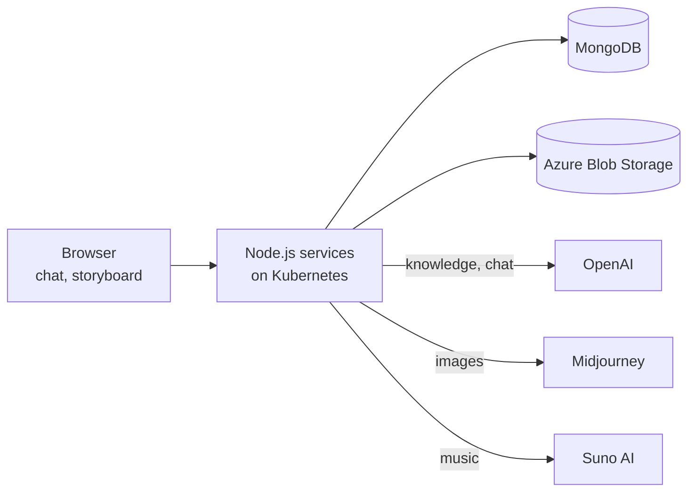
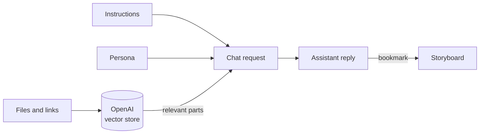

## What it is

**StorytellerAI** lets anyone build **their own AI assistant** and use it to create stories, much like the OpenAI Playground but built around your own content.

You create a **project** and teach the assistant what it needs to know:

- **Instructions:** how the assistant should behave and respond.
- **Personas:** the voice and character it should speak in.
- **Knowledge base:** files, public web pages and other resources it should learn from.

Then you **chat** with the assistant, and it answers using everything you gave it. Along the way you can **generate images and music**, **bookmark** the best answers, and arrange them on a **storyboard**: an infinite canvas where the story comes together.

```
Create project → add instructions, personas and knowledge → chat with the assistant
              → generate images and music → bookmark the best parts → build the storyboard
```

## Why it exists

General AI chat tools don't know your world. Every conversation starts from zero, so creative teams kept pasting the same background, tone and references again and again, and the good ideas ended up scattered across long chat histories.

| Problem | How StorytellerAI solves it |
| --- | --- |
| The AI doesn't know your story, brand or world | A **knowledge base** per project, built from your files and links, so every answer uses your material. |
| Tone and style change from chat to chat | **Instructions and personas** are saved with the project and applied to every conversation. |
| Text alone isn't enough for creative work | **Image and music generation** sit right next to the chat. |
| Good ideas get lost in long conversations | **Bookmark** any message and place it on the **storyboard**. |
| Ideas need structure to become a story | The **storyboard** is an infinite canvas where pieces can be arranged and connected. |

## Architecture

StorytellerAI uses the same stack as BeyondCaptions: **React and TypeScript** on the frontend and **Node.js** services with **MongoDB** on the backend. It runs on **Kubernetes on Azure**, with files stored in **Azure Blob Storage**, and connects to **OpenAI**, **Midjourney** and **Suno AI** for text, images and music.



| Part | What it does |
| --- | --- |
| **React app** | The chat, the project settings and the storyboard canvas. |
| **Node.js services** | Projects, knowledge bases, chats, generations and storyboards. |
| **MongoDB** | Stores projects, personas, instructions, chats, bookmarks and storyboards. |
| **Azure Blob Storage** | Keeps uploaded files and generated images and music. |
| **OpenAI** | Powers the assistant: the knowledge base search and the chat replies. |
| **Midjourney and Suno AI** | Generate images and music from the story. |

## How the assistant knows your content

The heart of StorytellerAI is giving the AI the right context for every answer.



- **Knowledge base:** when you add files or public links, they are sent to the **OpenAI Assistants API** and stored in a **vector database**. A vector database stores text by meaning, so the assistant can find the parts that matter for each question.
- **Instructions and personas** are turned into **custom prompts** that shape every reply.
- **Chat replies** come from OpenAI's completion API, combining your question, the instructions, the persona and the relevant knowledge.

## Images and music

Next to the chat, you can turn the story into visuals and sound:

- **Images** are generated with **Midjourney**.
- **Music** is generated with **Suno AI**.

Generated files are saved to **Azure Blob Storage**, so they stay with the project and can be placed on the storyboard.

## The storyboard

Long chats are a poor place to build a story. So any message can be **bookmarked** and added to the **storyboard**: an **infinite canvas** built with **React Flow**.

- Each piece (text, image or music) becomes a **node** on the canvas.
- Nodes can be **moved, grouped and connected** to show how the story flows.
- The canvas can be **zoomed and panned** freely, so a story of any size fits.

The result is one place where the ideas from many conversations turn into a single, organised story.

## Infrastructure

- **Kubernetes on Azure** runs the services.
- **Azure Blob Storage** keeps uploaded and generated files.
- **CircleCI** builds, tests and deploys every change automatically.

## Results

- **1,000+ users** on the platform.
- **85% faster** story creation, according to beta testers.

## Stack

React, TypeScript, Redux Toolkit, Tailwind CSS, React Flow, Node.js, Express, MongoDB, OpenAI Assistants API, Midjourney, Suno AI, Azure Kubernetes, Azure Blob Storage and CircleCI.
