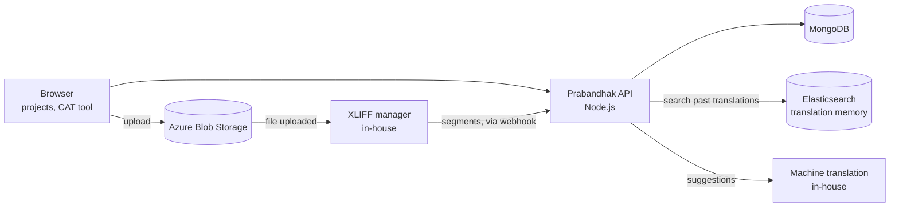
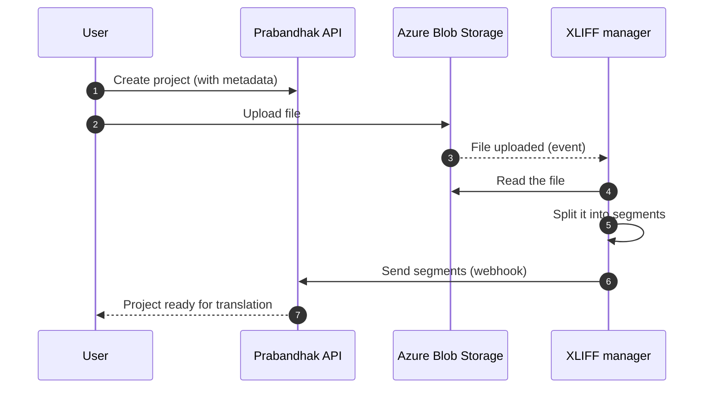
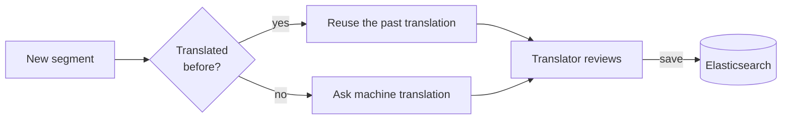

## What it is

**Prabandhak** is a text translation platform built for India's **low-resource languages**. It supports **18 Indian languages** and **32 file formats**, and brings everything a translation team needs into one place: projects, a translation editor, translation memory, team management and a freelancer marketplace.

It's used by Reverie's **in-house translation team**, by **language service providers (LSPs)** and **linguistic freelancers** across India, and by **government organisations** such as **GeM (Government e-Marketplace)**, the **Ministry of Education** and the **Ministry of Finance**. One of its biggest projects was localising a large volume of **taxation content** so taxpayers could read it in their own language.

```
Create project → upload file → file is split into segments → translators work in the CAT tool
              → reuse past translations or get machine suggestions → review → deliver
```

## Why it exists

Translating into Indian languages is harder than it looks. Good tools for low-resource languages were rare, typing in Indian scripts was slow, and the same sentences were translated again and again.

| Problem | How Prabandhak solves it |
| --- | --- |
| Content arrives in many different file types | Projects can be created from **32 file formats**, all turned into the same simple segments. |
| Typing in Indian scripts is slow | The built-in **Swalekh keyboard** makes typing in Indian languages fast. |
| Translating everything from scratch takes too long | **Machine translation** suggests a translation for every segment. |
| The same sentences get translated again and again | **Translation memory** finds past translations and reuses them. |
| Mistakes slip through in low-resource languages | **Spell and grammar checks** built for these languages. |
| Managing many translators is hard | **Teams, members and assignments** in one place. |
| Finding the right translator takes time | A **marketplace** where thousands of freelancers can bid on projects. |

## Architecture

The frontend is built with **React** and **Ant Design**. The backend runs on **Node.js** with **MongoDB**, uses **Elasticsearch** for the translation memory, and connects to two in-house services: an **XLIFF manager** that reads files, and a **machine translation (NMT)** engine.



| Part | What it does |
| --- | --- |
| **React + Ant Design** | Projects, the CAT tool, teams and the marketplace. |
| **Node.js API** | Projects, segments, teams, assignments and the marketplace. |
| **MongoDB** | Stores projects, segments, users and teams. |
| **Azure Blob Storage** | Keeps uploaded files. |
| **XLIFF manager** | An in-house Java library that reads files and turns them into segments. |
| **Elasticsearch** | Powers the translation memory search. |
| **Machine translation** | Reverie's in-house NMT engine, which suggests translations. |

## How a project is created

Creating a project is a small pipeline that runs in the background, so the user never waits for a large file to be processed.



1. **Add the project details**: name, languages and other metadata.
2. **Upload the file** to Azure Blob Storage.
3. **The upload triggers an event**, which sends the file to the **XLIFF manager**.
4. **The XLIFF manager reads the file** (any of the 32 formats) and splits it into **segments**: small pieces of text, usually a sentence each, saved as JSON.
5. **The segments are sent back** to Prabandhak through a **webhook**, and the project is ready to translate.

Because every file becomes the same kind of segments, the rest of the platform never needs to know whether the content came from a Word document, a spreadsheet or a web page.

## The CAT tool

I built the **CAT tool** (computer-assisted translation), the editor where translators spend their day. It shows each segment in the original language next to its translation, and gives translators the help they need right where they type:

- **Swalekh keyboard:** Reverie's keyboard for typing quickly in Indian languages.
- **Spell correction and grammar checks** designed for low-resource languages.
- **Machine translation suggestions:** the in-house NMT engine suggests a translation for the current segment, so translators edit instead of starting from a blank line.
- **Translation memory matches:** if this sentence was translated before, the earlier translation is shown first.
- **Glossary checks:** key terms are always translated the same way, so the final output stays consistent.

## Translation memory

Many documents repeat the same sentences: legal text, product names, standard phrases. Translating them again wastes time and money.



Every approved translation is saved in **Elasticsearch**. When a new segment arrives, Prabandhak **searches the memory first**. If the same text was already translated, it's reused right away. Only new text goes to the machine translation engine. This saves time, cuts cost, and keeps translations consistent across projects.

## Teams and projects

Prabandhak includes its own **project management**:

- **Create a team** and **add members** to it.
- **Assign projects** to members.
- **Automated workflows** handle the repetitive work: file handling, task assignment and quality checks.
- **Reports and analytics** show how each project and translator is doing, including turnaround time.

## The marketplace

India has a large community of **linguistic freelancers** and **language service providers**. Prabandhak connects them with work through a **marketplace**:

- **Post a project** to the marketplace.
- **Thousands of freelancers** can see it and **place bids**.
- The project owner **compares the bids** against their selection criteria and picks the right person.

## Infrastructure

- **Azure virtual machines** run the application.
- **PM2** keeps the Node.js services running, with **automatic restart** if a process crashes.
- **Azure Blob Storage** keeps uploaded files.

## Results

- **42% of words reused** from translation memory.
- **3.2× faster** review turnaround.

## Stack

React, Ant Design, Node.js, MongoDB, Elasticsearch, Azure Blob Storage, Azure VMs, PM2, plus Reverie's in-house XLIFF manager and machine translation engine.
