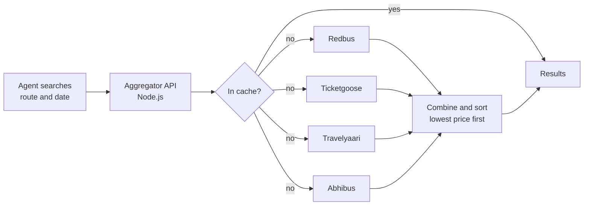

## What it was

**Tripborn** ran a booking portal for **travel agents**. Agents used it to book bus tickets for their customers across India.

Bus tickets came from several big providers: **Redbus**, **Ticketgoose**, **Travelyaari** and **Abhibus**. Each one had its own website and its own API, with different prices for the same route. To find the best fare, an agent had to check every provider one by one, compare prices by hand, and then book. It was slow, and agents often missed a cheaper option.

## What I built

I built a **ticket aggregator API** in **Node.js** and **MongoDB**. An agent searched once, and the aggregator asked all four providers at the same time, combined the answers, and showed one list with the **lowest price first**.

## How it worked

**One search, four providers.** The aggregator called all providers **in parallel**, so the total wait was close to the slowest single provider, not all four added together. If one provider was slow or down, the others still returned results.

**One common format.** Every provider described buses, seats, times and prices differently. Each response was converted into **one shared format**, so the rest of the app could sort and show results without caring where they came from.

**Lowest price first.** After combining the results, the list was sorted by price, so the best deal was always at the top.

**Caching popular routes.** Many agents searched the same busy routes again and again. Results for these routes were kept in **Redis** for a short time, so repeat searches came back instantly and didn't call every provider again.

**Keeping the API safe.** The API used **JWT authentication** so only logged-in agents could use it, and **rate limiting** so no single user could overload it.

## How the code was organised

I wrote the service using **object-oriented design** and **SOLID principles**. Each provider lived in its own small module with the same interface: search, convert to the common format, and book. Adding a new provider meant adding one new module, without changing the rest of the code.

## Result

- Agents searched **once instead of four times**.
- Search time dropped by about **75%**.
- Bookings went up by about **30%**, because agents could see the best fares straight away.

## Stack

Node.js, MongoDB, Redis and AWS.
